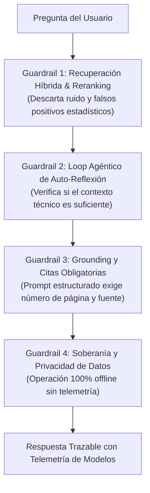

# Declaración de IA, Transparencia y Guardrails (AI Disclosure & Guardrails)

Este documento establece la **política de transparencia, trazabilidad de modelos, guardrails de seguridad y descargo de responsabilidad** de `rag-tutor`, en alineación con las buenas prácticas de IA responsable y el **Artículo 50 del AI Act de la Unión Europea**.

---

## 1. Declaración de Contenido Asistido por Inteligencia Artificial

> [!IMPORTANT]
> **Aviso de Transparencia:**  
> Las respuestas, síntesis pedagógicas y explicaciones generadas por `rag-tutor` son producidas por **modelos de lenguaje de gran escala (LLMs)** que operan de forma local a partir de fragmentos extraídos de la literatura técnica indexada.

Al igual que en proyectos pioneros de educación abierta como [`study-cybercirujas`](https://github.com/villadalmine/study-cybercirujas):
- **Herramienta de Asistencia al Estudio:** El tutor está diseñado exclusivamente como un asistente de estudio, consulta y preparación técnica.
- **Autoridad de Referencia:** Ningún chequeo algorítmico garantiza infalibilidad absoluta: un modelo de lenguaje puede formular un párrafo técnicamente convincente con citas que contenga interpretaciones incompletas o versiones de APIs obsoletas.  
- **Los libros de referencia originales y la documentación oficial de los vendors (CNCF, Linux Foundation, Python Software Foundation, etc.) constituyen la autoridad final.**

---

## 2. Guardrails Mecánicos y Arquitectónicos Implementados

Para garantizar el más alto nivel de fidelidad técnica y evitar alucinaciones, el sistema implementa **4 capas de guardrails automáticos en el código**:

### Guardrail 1: Filtro de Relevancia Cruzada (Cross-Encoder Reranker)
- **Problema que previene:** Evita que fragmentos que parecen cercanos estadísticamente por vocabulario común pero que no responden la pregunta lleguen al LLM.
- **Implementación:** El modelo `cross-encoder/ms-marco-MiniLM-L-6-v2` computa atención bidireccional sobre los 12 candidatos y entrega únicamente los 4 más relevantes al modelo generativo.

### Guardrail 2: Loop Agéntico de Auto-Reflexión (`src/core.py`)
- **Problema que previene:** Evita que el LLM "rellene vacíos" con suposiciones cuando el contexto inicial recuperado carece de código o arquitectura exacta.
- **Implementación:** En el Paso 1, el LLM evalúa si el contexto es suficiente. Si detecta ambigüedad, emite una sub-query dirigida (`NECESITO_MAS_INFO: [sub-query]`) para recuperar evidencia adicional antes de emitir su juicio final.

### Guardrail 3: Grounding Estricto y Citas de Fuentes
- **Problema que previene:** Respuestas abstractas desvinculadas de la bibliografía.
- **Implementación:** El prompt del sistema penaliza la invención de APIs o parámetros que no figuren en los libros, y fuerza la inclusión de las fuentes con número de página verificado.

### Guardrail 4: Soberanía de Datos y Cero Telemetría
- **Problema que previene:** Filtración de código, secretos o propiedad intelectual hacia APIs comerciales.
- **Implementación:** El sistema opera bajo `HF_HUB_OFFLINE=1` y Ollama local (`http://localhost:11434`). Ningún dato, prompt o fragmento de libro sale jamás de tu máquina hacia internet.

---

## 3. Trazabilidad y Proveniencia de Modelos

En cumplimiento con el principio de explicabilidad, cada interacción con el Tutor en la CLI, Servidor MCP y API REST expone de forma transparente la ficha técnica de los modelos intervinientes:

| Componente | Modelo Empleado | Proveedor / Origen | Rol en el Sistema |
| :--- | :--- | :--- | :--- |
| **Síntesis y Razonamiento** | `qwen2.5:7b` | QwenLM (Inferencia Local con Ollama) | Generación pedagógica y evaluación agéntica. |
| **Representación Vectorial** | `sentence-transformers/all-MiniLM-L6-v2` | UKP Lab (Hugging Face) | Computación de embeddings densos (384 dims). |
| **Re-clasificación de Relevancia** | `cross-encoder/ms-marco-MiniLM-L-6-v2` | UKP Lab (Hugging Face) | Puntuación de similitud cruzada query-documento. |
| **Búsqueda Léxica Exacta** | BM25 Okapi | rank_bm25 | Captura exacta de identificadores y comandos. |

---

## 4. Licencia y Uso Ético

- **Código del Proyecto:** Distribuido bajo la **Licencia Apache 2.0** (código abierto, permisivo, para uso personal, educativo y comercial). Ver [LICENSE](LICENSE).
- **Material Bibliográfico (Filosofía BYOB - Bring Your Own Books):** El repositorio **NO distribuye, aloja ni incluye libros, PDFs ni contenido protegido por derechos de autor**. Cada usuario aporta sus propios libros técnicos legalmente adquiridos colocándolos en `books/`. El software actúa exclusivamente como un indexador y tutor local privado (*fair use* / copia de estudio personal). El motor es 100% universal y soporta cualquier libro técnico de cualquier editorial o temática (Bases de datos, Cloud, Web, Rust, Python, DevOps, Ciberseguridad, etc.).
