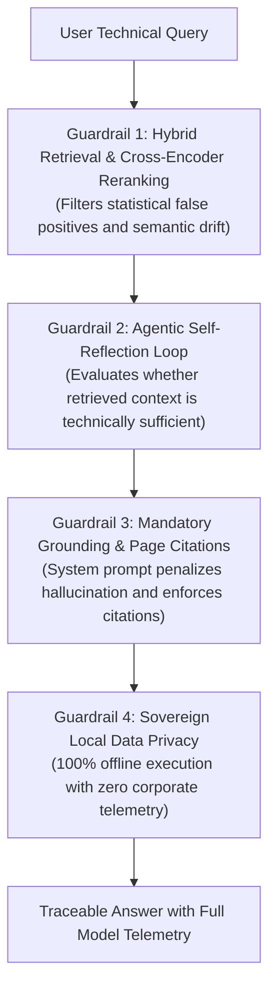

# AI Disclosure, Transparency & Safety Guardrails

This document establishes the **transparency policy, model provenance, architectural guardrails, and educational disclaimer** for `rag-tutor`, in full alignment with responsible AI principles and **Article 50 of the European Union AI Act**.

---

## 1. AI-Generated & Assisted Content Disclosure

> [!IMPORTANT]
> **Transparency Notice:**  
> Answers, educational explanations, and synthesized code produced by `rag-tutor` are generated by **local Large Language Models (LLMs)** operating over technical fragments extracted from indexed reference literature.

In alignment with open educational initiatives like [`study-cybercirujas`](https://github.com/villadalmine/study-cybercirujas):
- **Study Aid Notice:** The tutor is designed strictly as a personal study assistant, technical guide, and query interface.
- **Reference Authority:** No automated check can guarantee that an explanation is 100% infallible: an LLM can formulate a confident, well-cited paragraph that contains subtle inaccuracies or outdated API references.
- **The original published engineering books and the official vendor documentation (CNCF, Linux Foundation, Python Software Foundation, etc.) remain the ultimate technical authority.**

---

## 2. Mechanical & Architectural Guardrails

To prevent hallucinations and guarantee the highest degree of technical fidelity, the codebase implements **4 automated guardrail layers**:

### Guardrail 1: Cross-Encoder Relevance Reranking (`ms-marco-MiniLM-L-6-v2`)
- **Failure Mode Prevented:** Eliminates false-positive documents that share vocabulary keywords but do not actually answer the query intent.
- **Implementation:** The Cross-Encoder computes full bidirectional self-attention over the top 12 hybrid candidates and forwards only the top 4 pure chunks to the generative model.

### Guardrail 2: Agentic Self-Reflection Loop (`src/core.py`)
- **Failure Mode Prevented:** Prevents the LLM from "guessing" or filling knowledge gaps when initial retrieval misses exact syntax or manifests.
- **Implementation:** In Step 1, the LLM evaluates context sufficiency. If information is incomplete, it issues an automated targeted sub-query (`NECESITO_MAS_INFO: [sub-query]`) to retrieve additional evidence before committing to a final answer.

### Guardrail 3: Mandatory Grounding & Book Page Citations
- **Failure Mode Prevented:** Unsubstantiated claims detached from verified literature.
- **Implementation:** The system prompt strictly penalizes the invention of non-existent APIs, CLI flags, or parameters, and enforces verified page citations for every claim.

### Guardrail 4: Complete Data Sovereignty & Zero Telemetry
- **Failure Mode Prevented:** Leakage of proprietary code, terminal outputs, or intellectual property to commercial AI APIs.
- **Implementation:** Operates under `HF_HUB_OFFLINE=1` and local Ollama (`http://localhost:11434`). No prompt, book chunk, or vector embedding ever leaves your workstation.

---

## 3. Model Traceability & Provenance

In compliance with explainability guidelines, every interaction via CLI, MCP Server, and REST API surfaces complete technical telemetry:

| Pipeline Component | Active Model | Origin / Provider | Role in the System |
| :--- | :--- | :--- | :--- |
| **Reasoning & Synthesis** | `qwen2.5:7b` | QwenLM (Local Ollama inference) | Educational synthesis and agentic reflection. |
| **Dense Vector Embeddings** | `sentence-transformers/all-MiniLM-L6-v2` | UKP Lab (Hugging Face) | 384-dimensional dense semantic embeddings. |
| **Relevance Reranking** | `cross-encoder/ms-marco-MiniLM-L-6-v2` | UKP Lab (Hugging Face) | Deep query-document cross-attention scoring. |
| **Exact Lexical Search** | BM25 Okapi | rank_bm25 | Exact token matching for code, CRDs, and CLI commands. |

---

## 4. Licensing & Ethical Usage

- **Project Software:** Distributed under the **Apache License 2.0** (permissive open-source for personal, educational, and commercial use). See [LICENSE](LICENSE).
- **Bibliographic Content (BYOB - Bring Your Own Books):** This repository **does NOT host, distribute, or bundle copyrighted books or PDFs**. Each user provides their own legally acquired technical literature by placing it into `books/`. The software operates strictly as a private, local indexer and study assistant (*fair use* personal study copy). The engine is 100% universal across all publishers and technical subjects.
