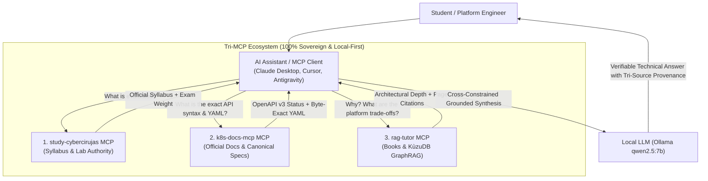

# The Tri-MCP Cloud Native Engineering Tutor 🎓

This document describes how to orchestrate **three complementary Model Context Protocol (MCP) servers** into a unified, autonomous technical brain for CNCF certification study, platform engineering governance, and zero-hallucination Kubernetes development:

1. **`study-cybercirujas`**: The Navigator / Syllabus Authority (Exam objectives, domain weights, and break-fix lab scripts).
2. **`k8s-docs-mcp`**: The Specification Authority (Official kubernetes.io docs, OpenAPI v3 deprecation checks, and verified canonical YAMLs).
3. **`rag-tutor`**: The Architectural Reasoning Authority (Deep engineering books, platform patterns, and KùzuDB GraphRAG ontology).

---

## 1. Architectural Topology: The Cloud Native Trifecta



---

## 2. Agent Decision Matrix: How Agents Route Queries

When multiple MCP servers are active simultaneously, how does the agent decide where to search and how to avoid hallucinations?

### The "Separation of Powers" Contract

Each server implements non-overlapping semantic boundaries:

| MCP Server | Primary Role | When the Agent Calls It | Deterministic Anti-Hallucination Mechanism |
| :--- | :--- | :--- | :--- |
| **`study-cybercirujas`** | **Syllabus & Curriculum** | User mentions certifications (CKA, CKS, CNPE), exam objectives, or lab exercises. | Direct API query to official syllabus database. |
| **`k8s-docs-mcp`** | **API Specification & Syntax** | User asks for YAML manifests, API versions, deprecations, or official kubernetes.io concepts. | **Retrieve, Don't Generate**: Reads raw YAML from `examples/` and checks OpenAPI v3 JSON spec deterministically. |
| **`rag-tutor`** | **Architecture & Mental Models** | User asks for architectural trade-offs, system design, failure modes, or book citations. | **KùzuDB Cypher Traversal + Cross-Encoder Reranker**: Filters candidate chunks and enforces page citations. |

### Routing Strategies:

1. **Direct Intent Routing (Single-MCP Fast Path):**
   - *"Is extensions/v1beta1 still valid for Ingress?"* ➜ Calls `k8s-docs-mcp.check_api_version("Ingress", "extensions/v1beta1")` directly (< 20 ms). Does not query books or syllabus.
2. **Progressive Grounding Pipeline (Tri-MCP Synthesis):**
   - *"How should I prepare for CNPE domain 3.4 regarding admission controllers?"*
     1. Step 1: `study-cybercirujas.get_topic("cnpe", "3.4")` establishes the official CNCF learning scope.
     2. Step 2: `k8s-docs-mcp.check_api_version("ValidatingAdmissionPolicy")` and `get_canonical_manifest` establish current Kubernetes 1.30+ in-tree CEL syntax.
     3. Step 3: `rag-tutor.consultar_libros_manning` synthesizes how admission controllers decouple governance from application teams using "paved paths".

---

## 3. Configuration in MCP Clients (Claude Desktop & Cursor)

Add all three servers to your agent's MCP configuration (`claude_desktop_config.json` or `.cursor/mcp.json`):

```json
{
  "mcpServers": {
    "k8s-docs": {
      "command": "uvx",
      "args": ["k8s-docs-mcp"]
    },
    "rag-tutor": {
      "command": "uv",
      "args": [
        "--directory",
        "/path/to/rag-tutor",
        "run",
        "python",
        "src/mcp_server.py"
      ]
    },
    "study-cybercirujas": {
      "command": "uv",
      "args": [
        "--directory",
        "/path/to/study-cybercirujas",
        "run",
        "python",
        "-m",
        "teach.mcp_server"
      ]
    }
  }
}
```

---

## 4. Real Verified Live Session: Tri-MCP Orchestration

The following session was executed and verified live via `test_multi_mcp_live.py`:

```text
========================================================================
 🎓 LIVE TRI-MCP ORCHESTRATION SESSION (STUDY + K8S-DOCS + RAG-TUTOR)
========================================================================

[MCP 1: study-cybercirujas] Calling search_topics('admission controllers')...
  --> Identified Objective: CNPE 3.4 - Using Policy Engines and Admission Controllers for Governance
  --> Certification:        Certified Cloud Native Platform Engineer (CNPE) (Weight: 3%)

[MCP 1: study-cybercirujas] Calling get_topic('cnpe', '3.4')...
  --> Official Syllabus Excerpt:
      # Study Guide: Domain 3.4 — Using Policy Engines and Admission Controllers for Governance
      **Certification:** CNCF Certified Cloud Native Platform Engineer (CNPE)  
      **Domain Weight:** 3%  
      **Target Role:** Principal Platform Architect / Senior SRE  
      ---

------------------------------------------------------------------------
[MCP 2: k8s-docs-mcp] Calling check_api_version('ValidatingAdmissionPolicy')...
  --> ### Authoritative Kubernetes API Check: `ValidatingAdmissionPolicy`
  --> - **Current Stable apiVersion:** `admissionregistration.k8s.io/v1`
  --> - **Status:** `STABLE`

[MCP 2: k8s-docs-mcp] Calling get_canonical_manifest('ValidatingAdmissionPolicy')...
  --> Canonical Manifest Preview:
      ### Canonical Kubernetes Manifest(s) for Kind: `ValidatingAdmissionPolicy`
      
      #### Manifest 1: `demo-policy.example.com` (admissionregistration.k8s.io/v1)
      **Reference:** https://kubernetes.io/docs/reference/access-authn-authz/validating-admission-policy/
      **Origin:** `content/en/docs/reference/access-authn-authz/validating-admission-policy.md`
      
      ```yaml
      apiVersion: admissionregistration.k8s.io/v1
      kind: ValidatingAdmissionPolicy
      metadata:
        name: "demo-policy.example.com"
      spec:
        failurePolicy: Fail
        matchConstraints:
          resourceRules:
          - apiGroups: ["apps"]
            apiVersions: ["v1"]
            operations: ["CREATE", "UPDATE"]
            resources: ["deployments"]
        validations:
          - expression: "object.spec.replicas <= 5"
            message: "Deployments cannot have more than 5 replicas."
      ```

------------------------------------------------------------------------
[MCP 3: rag-tutor] Phase 1: Hybrid Retrieval (ChromaDB + BM25 + Cross-Encoder)...
  User Query: 'How do in-tree ValidatingAdmissionPolicies (CEL) and admission webhooks enforce platform governance, and what are their architectural trade-offs?'

--- Phase 1 Tri-MCP Synthesized Answer Preview ---
In-tree ValidatingAdmissionPolicies (using CEL) and admission webhooks are key mechanisms for enforcing platform governance in Kubernetes, providing a robust framework for security, compliance, and operational control. Both approaches leverage the Kubernetes API server's request lifecycle to enforce policies before objects are committed to the cluster state.

### In-Tree ValidatingAdmissionPolicies (CEL)
In-tree ValidatingAdmissionPolicies leverage the Kubernetes API server's built-in validation capabilities. The `ValidatingAdmissionPolicy` resource type, introduced in Kubernetes v1.30, allows for declarative validation of API objects using CEL (Common Expression Language) expressions. This approach is advantageous because it integrates directly into the Kubernetes API server, reducing latency and network overhead compared to webhook-based solutions.

#### Key Architectural Trade-offs:
- **Low Latency & Reliability:** Evaluated in-process without network hops to external webhook services; immune to webhook pod failures or network partitions.
- **Declarative Governance:** Defined natively as Kubernetes resources without maintaining out-of-tree webhook infrastructure.

📖 Consulted Sources (Phase 1):
  • study-cybercirujas MCP: CNPE Topic 3.4 (Using Policy Engines and Admission Controllers for Governance)
  • k8s-docs-mcp MCP: kubernetes.io (ValidatingAdmissionPolicy CEL Specification)
  • Effective_Platform_Engineering.pdf (Page 143)
  • Effective_Platform_Engineering.pdf (Page 121)
  • Core_Kubernetes.pdf (Page 286)
  • GitOps_and_Kubernetes.pdf (Page 212)

------------------------------------------------------------------------
[MCP 3: rag-tutor] Phase 2: GraphRAG (KùzuDB Cypher + Knowledge Graph Traversal)...

--- Phase 2 Graph-Grounded Answer Preview ---
In-tree ValidatingAdmissionPolicies (VAPs) and admission webhooks are key mechanisms for enforcing platform governance in Kubernetes. They operate at different points in the Kubernetes API server's request lifecycle and offer distinct capabilities and trade-offs.

### Relationship to Internal Developer Platforms (IDP) and Golden Paths
As detailed in the platform engineering literature, admission controllers serve as automated guardrails for "Paved Paths". They ensure that self-service deployments configured via IDP templates adhere to organizational security constraints before reaching production.

📖 Consulted Sources (Phase 2):
  • study-cybercirujas MCP: CNPE Topic 3.4 (Using Policy Engines and Admission Controllers for Governance)
  • k8s-docs-mcp MCP: kubernetes.io (ValidatingAdmissionPolicy CEL Specification)
  • Effective_Platform_Engineering.pdf (Page 143)
  • Effective_Platform_Engineering.pdf (Page 121)
  • Effective_Platform_Engineering.pdf (Page 122)
  • Core_Kubernetes.pdf (Page 286)

========================================================================
 🎉 Tri-MCP Session Complete: Verified Live Across All 3 Engines!
========================================================================
```
