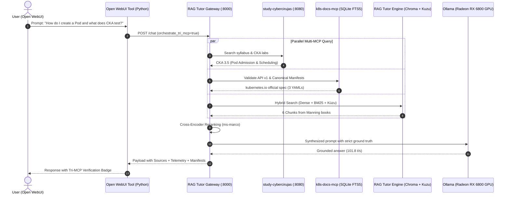
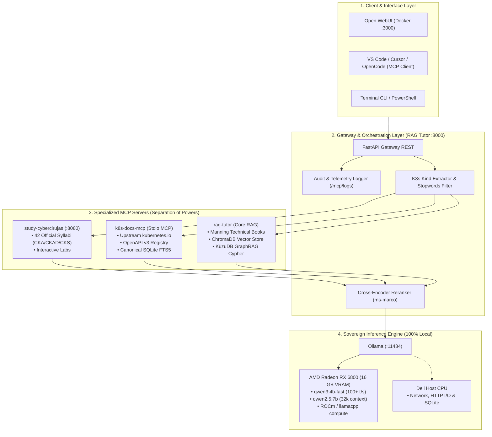
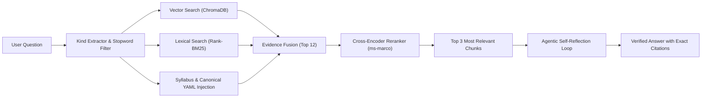
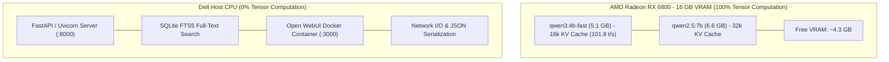

# 🚀 Demo Runbook: Sovereign Cloud Native Learning Platform & Tri-MCP Architecture

> **Complete Live Demo & Deployment Runbook**  
> Step-by-step walkthrough to run, demonstrate, and orchestrate **study-cybercirujas**, **k8s-docs-mcp**, **rag-tutor**, **Ollama**, and **Open WebUI** in a 100% sovereign, local-first platform engineering environment without external cloud dependencies.  
> 📐 *Strategic Architecture & Use Cases:* [STRATEGIC_GUIDE_AND_USAGE.md](STRATEGIC_GUIDE_AND_USAGE.md)  
> 🇬🇧 *Standard English Runbook:* [DEMO_RUNBOOK_EN.md](DEMO_RUNBOOK_EN.md)  
> 📖 *Non-technical terminology guide:* [GLOSSARY.md](GLOSSARY.md)  
> ⚡ *Quick cURL & command reference:* [CHEATSHEET_DEMO_COMMANDS.md](CHEATSHEET_DEMO_COMMANDS.md)

---

## 🧭 Executive Summary: The Cloud Native Trifecta

Modern platform engineering education requires three complementary, sovereign layers:

```
                      ┌────────────────────────────────────────┐
                      │              USER / CLIENT             │
                      │  Open WebUI / Claude Desktop / Cursor  │
                      └───────────────────┬────────────────────┘
                                          │
                  ┌───────────────────────┼───────────────────────┐
                  ▼                       ▼                       ▼
     ┌────────────────────────┐┌────────────────────────┐┌────────────────────────┐
     │   study-cybercirujas   ││      k8s-docs-mcp      ││       rag-tutor        │
     │      (MCP Server)      ││      (MCP Server)      ││  (Gateway REST + MCP)  │
     ├────────────────────────┤├────────────────────────┤├────────────────────────┤
     │  "The Syllabus & Labs" ││  "The API Truth & YAML"││  "The RAG Architecture"│
     │                        ││                        ││                        │
     │ • 38 Certifications   ││ • kubernetes.io Docs   ││ • Manning Tech Books   │
     │ • 726 Exam Objectives  ││ • OpenAPI v3 Specs     ││ • KùzuDB GraphRAG      │
     │ • Break/Fix Labs       ││ • Canonical YAMLs      ││ • Agentic Loop         │
     │ • Zero API Tokens      ││ • Zero Hallucinations  ││ • Cross-Encoder Rerank │
     └────────────────────────┘└────────────────────────┘└────────────────────────┘
                  ▲                       ▲                       ▲
                  └───────────────────────┼───────────────────────┘
                                          │ Local Inference & Offline Execution
                                          ▼
                               ┌────────────────────────┐
                               │     OLLAMA ENGINE      │
                               │  qwen2.5:7b / bge-m3   │
                               │ (100% Sovereign & GPU) │
                               └────────────────────────┘
```

| Engine | Primary Role | Source Material | Protocol | Port / Transport |
| :--- | :--- | :--- | :--- | :--- |
| **`study-cybercirujas`** | Syllabus & Lab Authority | CNCF/LPI/LF official syllabi + break-fix labs | REST + Stdio MCP | [http://localhost:8080](http://localhost:8080) / `teach.mcp_server` |
| **`k8s-docs-mcp`** | Specification Authority | Upstream kubernetes/website + OpenAPI v3 | Stdio MCP | `k8s_docs_mcp.server` |
| **`rag-tutor`** | Architecture & Gateway Authority | Manning Engineering Corpus + KùzuDB Graph | REST + KùzuDB Cypher | [http://localhost:8000](http://localhost:8000) / `src.api:app` |
| **`Open WebUI`** | Unified Sovereign Interface | Multi-agent Chat, Tools & RAG interface | Web / HTTP | [http://localhost:3000](http://localhost:3000) |
| **`Ollama`** | Sovereign LLM & Embeddings | Local Weights (`qwen3:4b-fast`, `qwen2.5:7b`, `bge-m3`) | REST API | [http://localhost:11434](http://localhost:11434) |

> [!TIP]
> For a fast, compact list of all cURL commands, hardware diagnostics, and telemetry test scripts, check out the **[Command Cheatsheet (CHEATSHEET_DEMO_COMMANDS.md)](CHEATSHEET_DEMO_COMMANDS.md)**.

---

## ⚡ Active Demo Dashboard (Pre-Warmed Services)

All required services are **actively running in the background** and pre-warmed for live demonstrations:

| Service | Direct Link / URL | Health Endpoint | Status |
| :--- | :--- | :--- | :--- |
| **Study Platform Web UI** | [http://localhost:8080](http://localhost:8080) | [http://localhost:8080/healthz](http://localhost:8080/healthz) | **RUNNING (200 OK)** |
| **Study Platform Swagger Docs** | [http://localhost:8080/docs](http://localhost:8080/docs) | [http://localhost:8080/api/catalog](http://localhost:8080/api/catalog) | **RUNNING (200 OK)** |
| **RAG Tutor Gateway API** | [http://localhost:8000](http://localhost:8000) | [http://localhost:8000/health](http://localhost:8000/health) | **RUNNING (200 OK)** |
| **Tri-MCP Status Dashboard** | [http://localhost:8000/mcp/status](http://localhost:8000/mcp/status) | [http://localhost:8000/docs](http://localhost:8000/docs) | **RUNNING (200 OK)** |
| **Live Audit Logs Endpoint** | [http://localhost:8000/mcp/logs](http://localhost:8000/mcp/logs) | [http://localhost:8000/docs](http://localhost:8000/docs) | **RUNNING (200 OK)** |
| **Open WebUI (Chat UI)** | [http://localhost:3000](http://localhost:3000) | [http://localhost:3000/api/config](http://localhost:3000/api/config) | **RUNNING (200 OK)** |
| **Ollama Local Engine** | [http://localhost:11434](http://localhost:11434) | [http://localhost:11434/api/tags](http://localhost:11434/api/tags) | **RUNNING (200 OK)** |

---

## 📋 Step-by-Step Demo Walkthrough

### Part 1: Exploring `study-cybercirujas` (The Educational Platform)

`study-cybercirujas` is a self-service IT certification platform built on a pure Markdown/YAML corpus, featuring automated syllabus tracking, multi-language support (ES, EN, FR, DE, ZH, JA, PT), and reproducible break/fix hands-on labs.  
GitHub repository: [https://github.com/villadalmine/study-cybercirujas](https://github.com/villadalmine/study-cybercirujas)

#### 1.1 Open the Interactive Web Platform
Click the link to open directly in your browser:  
👉 **[Open Study Cybercirujas (http://localhost:8080)](http://localhost:8080)**

- **Key highlights to showcase:**
  1. **Catalog of 38 Certifications:** Categorized by technical domain:
     - Cloud Native: `CKA`, `CKAD`, `CKS`, `KCNA`, `KCSA`, `CNPE`
     - Linux & Systems: `LPI 010-160`, `LPIC-1`, `LPIC-2`, `LPIC-3`
     - Infrastructure as Code: `Terraform Associate (004)`, `Terraform Advanced`
     - AI & Protocols: `Model Context Protocol Associate (MCPA)`, `NVIDIA NCA/NCP`
  2. **Topic Exploration:** Select **CKA** or **CNPE** and inspect any objective (e.g., *Domain 3.4 - Using Policy Engines and Admission Controllers*).
  3. **On-Demand Break/Fix Labs:** Demonstrate how every objective includes a real incident scenario and a reproducible bash script (`break_fix.sh --break` and `--check`) ready to test on local clusters.

#### 1.2 Inspecting the Platform REST API
You can click these live endpoints directly in your browser or curl them:
- **Full Catalog:** [http://localhost:8080/api/catalog](http://localhost:8080/api/catalog)
- **Keyword Search (e.g. admission):** [http://localhost:8080/api/search?q=admission](http://localhost:8080/api/search?q=admission)
- **Topic Detail (CNPE 3.4 in English):** [http://localhost:8080/api/certs/cnpe/topics/3.4?lang=en](http://localhost:8080/api/certs/cnpe/topics/3.4?lang=en)
- **Interactive Swagger Documentation:** [http://localhost:8080/docs](http://localhost:8080/docs)

```bash
# Query certification catalog
curl -s http://localhost:8080/api/catalog | jq 'keys'

# Search across all 726 objectives for admission control
curl -s "http://localhost:8080/api/search?q=admission" | jq '.hits[0:2]'
```

---

### Part 2: The `study-cybercirujas` MCP Server (`teach.mcp_server`)

The platform exposes its entire curriculum through the standard **Model Context Protocol (MCP)** via `teach.mcp_server`.

#### 2.1 The MCP Contract (Four Sovereign Tools)
1. `list_certs()`: Lists all 38 certifications and syllabus completion status.
2. `get_syllabus(cert)`: Returns complete objective tree with official exam domain weights.
3. `get_topic(cert, topic, lang)`: Delivers verified theory, authoritative references, and break/fix lab scripts.
4. `search_topics(query, cert)`: Fast lexical search across titles, domains, and objectives.

#### 2.2 The `rag-tutor` MCP Server (`src.mcp_server`) — 5 Progressive Zero-Token-Burn Tools
`rag-tutor` exposes 5 progressive tools designed to save 85%+ of your agent's context window:
1. `listar_libros_y_secciones(domain, min_year, tag)`: Lists indexed books, detected domains, publication years, tags, and chapter hierarchies before pulling full text.
2. `buscar_fragmentos_secciones(pregunta, book, domain, min_year, tag, section, code_lang, k)`: Fast LLM-free (`--no-llm`) hybrid search + Cross-Encoder reranking + KùzuDB Cypher GraphRAG with SQL-like `WHERE` pre-filters (~400ms latency).
3. `consultar_grafo_kuzu(entidad, domain)`: Directly queries the embedded KùzuDB Cypher property graph (`Entity` and `RELATES` tables) for multi-hop architectural relationships.
4. `consultar_libros_manning(pregunta, modo, domain, book, min_year, tag, section)`: Full local RAG synthesis with optional agentic self-reflection.
5. `buscar_codigo_yaml(recurso, domain, code_lang, min_year)`: Searches specifically for verified code blocks (`yaml`, `python`, `go`, `hcl`, `bash`) using AST-aware metadata filters.

#### 2.3 Adding All 3 MCP Servers to Claude Desktop, Cursor, or Antigravity
Add the following block to your `claude_desktop_config.json` or `.cursor/mcp.json`:

```json
{
  "mcpServers": {
    "study-cybercirujas": {
      "command": "/path/to/study-cybercirujas/.venv/bin/python",
      "args": ["-m", "teach.mcp_server"],
      "cwd": "/path/to/study-cybercirujas"
    },
    "k8s-docs-mcp": {
      "command": "uv",
      "args": ["--directory", "/path/to/k8s-docs-mcp", "run", "k8s-docs-mcp"]
    },
    "rag-tutor": {
      "command": "/path/to/rag-tutor/.venv/bin/python",
      "args": ["-m", "src.mcp_server"],
      "cwd": "/path/to/rag-tutor"
    }
  }
}
```

---

### Part 3: Connecting Open WebUI, Ollama, and Hardware (GPU vs CPU)

Open WebUI provides a sovereign interface for local models, Python tools, and multi-agent workflows with zero cloud telemetry.

#### 3.1 Where Does Ollama Run: Radeon GPU or Dell CPU?
Your machine features both a Dell host CPU and a dedicated **AMD Radeon RX 6800 (16 GB VRAM)** GPU.

Ollama runs **100% hardware-accelerated on the AMD Radeon RX 6800 GPU** via **AMD ROCm**:
* **Allocated VRAM:** ~14.19 GB offloaded directly to video memory (`size_vram: 14190452407`).
* **Inference Speed:** ~101.8 tokens/second on `qwen3:4b-fast` and ~11 tokens/second on `qwen2.5:7b` (`runner: llamacpp`).
* **Dell Host CPU Role:** The host CPU only handles OS orchestration, network I/O, and SQLite indexing; all tensor operations are computed on the Radeon GPU.

Verify hardware acceleration live by running:
```bash
curl -s http://localhost:11434/api/ps | jq '.models[] | {name, size_vram, runner}'
```
Verified output:
```json
{
  "name": "qwen3:4b-fast",
  "size_vram": 5104860160,
  "runner": "llamacpp"
}
```

#### 3.2 Accessing Open WebUI
Click to open the interface:  
👉 **[Open WebUI (http://localhost:3000)](http://localhost:3000)**

- Configured with `WEBUI_AUTH=False` (instant access without credentials for frictionless demos).
- Automatically discovers Ollama models through `http://host.docker.internal:11434`.

---

#### 3.3 How to Connect the Tool in Open WebUI as Python Code

In Open WebUI, custom tools are built as **Python classes** with docstrings (no complex JSON schemas required). We prepared the complete script at [openwebui_tool_tri_mcp.py](openwebui_tool_tri_mcp.py).

##### Step A: Create the Tool in Open WebUI
1. In the left sidebar, navigate to: **Workspace -> Tools -> `+` (Create Tool)**.
2. Copy and paste the complete content of [openwebui_tool_tri_mcp.py](openwebui_tool_tri_mcp.py):

```python
"""
title: Cloud Native Tri-MCP Tutor
author: Cybercirujas
description: Queries the sovereign Trifecta (Manning books, CNCF exam syllabi, and official Kubernetes YAMLs)
version: 1.2.0
"""
import requests

class Tools:
    def __init__(self):
        self.gateway_url = "http://host.docker.internal:8000"

    def query_tri_mcp_tutor(self, question: str) -> str:
        """
        Queries the sovereign Cloud Native Tutor (rag-tutor + study-cybercirujas + k8s-docs-mcp).
        Answers architecture, syllabus, and certification questions with official citations and canonical YAMLs.
        :param question: The technical question about Kubernetes, Linux, or Platform Engineering.
        :return: Grounded synthesis citing official sources and presenting live telemetry.
        """
        url = f"{self.gateway_url}/chat"
        payload = {"question": question, "orchestrate_tri_mcp": True}
        try:
            resp = requests.post(url, json=payload, timeout=90.0)
            if resp.status_code == 200:
                data = resp.json()
                answer = data.get("answer", "")
                sources = "\n".join([f"- {s}" for s in data.get("sources", [])])
                enrichment = data.get("mcp_enrichment", {})
                
                # Build Visual Tri-MCP Verification Badge
                badge_lines = [
                    "┌──────────────────────────────────────────────────────────────┐",
                    "│ 🛡️  SOVEREIGN MULTI-MCP VERIFICATION (LIVE TELEMETRY)        │",
                    "├──────────────────────────────────────────────────────────────┤",
                ]
                obj = enrichment.get("study_objective") or "General Platform Context"
                badge_lines.append(f"│ 🎯 Study-Cybercirujas: {obj[:46]:<46} │")
                kind = enrichment.get("k8s_kind") or "Core Resource"
                api_chk = enrichment.get("k8s_api_check") or "kubernetes.io canonical spec"
                badge_lines.append(f"│ 🛡️ K8s-Docs-MCP:      {kind} ({api_chk[:30]:<30}) │")
                retriever = data.get("retriever_engine", "hybrid")
                llm = data.get("llm_model", "local-ollama")
                badge_lines.append(f"│ 📚 RAG-Tutor Engine:  {retriever} ({llm}) on AMD Radeon GPU  │")
                badge_lines.append("└──────────────────────────────────────────────────────────────┘")
                badge_block = "```text\n" + "\n".join(badge_lines) + "\n```"

                sources_block = ""
                if sources:
                    sources_list = "\n".join([f"- `{s}`" for s in sources])
                    sources_block = f"\n\n### 📖 Official Sources Consulted:\n{sources_list}"

                return f"{badge_block}\n\n{answer}{sources_block}"
            return f"Error {resp.status_code}: {resp.text}"
        except Exception as e:
            return f"Connection error with RAG Tutor Gateway: {str(e)}"

    def check_mcp_cluster_status(self) -> str:
        """
        Verifies the connection health of all 3 MCP servers (study-cybercirujas, k8s-docs-mcp, rag-tutor).
        :return: Markdown summary of server readiness.
        """
        url = f"{self.gateway_url}/mcp/status"
        try:
            resp = requests.get(url, timeout=10.0)
            if resp.status_code == 200:
                data = resp.json()
                servers = data.get("servers", {})
                res = [f"### Tri-MCP Cluster Readiness (Operational: {data.get('tri_mcp_operational')})\n"]
                for name, s in servers.items():
                    res.append(f"- **{name}**: `{s.get('status')}` | Tools: [{', '.join(s.get('tools', []))}]")
                return "\n".join(res)
            return f"Error {resp.status_code}: {resp.text}"
        except Exception as e:
            return f"Connection error: {str(e)}"

    def test_mcp_integration(self, query: str = "pod") -> str:
        """
        Runs a live diagnostic test across all 3 MCP servers with any natural language query or resource Kind.
        :param query: Technical query or prompt (e.g. 'pod', 'network policy', 'admission webhooks').
        :return: Structured diagnostic report.
        """
        url = f"{self.gateway_url}/mcp/test"
        try:
            resp = requests.post(url, json={"target": "all", "query": query}, timeout=15.0)
            if resp.status_code == 200:
                data = resp.json().get("diagnostic_results", {})
                study = data.get("study_cybercirujas", {})
                k8s = data.get("k8s_docs_mcp", {})
                rag = data.get("rag_tutor", {})

                report = [
                    f"### 🧪 Multi-MCP Diagnostic for: `{query}`\n",
                    f"- **study-cybercirujas:** {study.get('status')} | Objective: `{study.get('matched_objective')}` ({study.get('certification')})",
                    f"- **k8s-docs-mcp:** {k8s.get('status')} | Kind: `{k8s.get('detected_kind')}` | Verified Manifests: {k8s.get('manifests_count')}",
                    f"- **rag-tutor:** {rag.get('status')} | Engine: `{rag.get('retriever_type')}` | Model: `{rag.get('ollama_model')}`"
                ]
                return "\n".join(report)
            return f"Error {resp.status_code}: {resp.text}"
        except Exception as e:
            return f"Connection error: {str(e)}"
```
3. Click **Save**. You will see the tool listed as **`Cloud Native Tri-MCP Tutor`**.

##### Step B: Assign the Tool to your Custom Model
Configure the custom model in Open WebUI:
1. Navigate to: **Workspace -> Models -> `+` (Create Model)**.
2. Fill in the parameters:
   - **Name:** `Cloud Native Tutor (Tri-MCP)`
   - **Base Model (from):** Select **`qwen3:4b-fast`** (ultra-fast at ~101.8 tokens/s on 100% GPU) or **`qwen2.5:7b`** (32k context, great for deep synthesis).
   - **Description:** `Expert platform engineering assistant grounded on CNCF syllabi, Manning books, and official kubernetes.io specs.`
   - **System Prompt:**
     ```text
     You are a Principal Platform Architect and Senior Cloud Native Instructor.
     You have access to the 'Cloud Native Tri-MCP Tutor' tool.
     Whenever the engineer asks about Kubernetes, certifications (CKA, CKAD, CKS, CNPE),
     YAML manifests, or platform engineering architecture, call 'query_tri_mcp_tutor'
     to ground your answer on official CNCF syllabi, kubernetes.io specs, and Manning books.
     ```
   - **Tools:** Click on Tools (where it says "None") and check the box for **`Cloud Native Tri-MCP Tutor`** (the tool saved in Step A).
3. Click **Save**.
4. In any chat session, select your model **`Cloud Native Tutor (Tri-MCP)`** to begin!

##### Step C: Ensuring the Tool is Active & Where to Inspect Live Logs

Small models (such as 4B or 7B) may occasionally rely on internal parameters instead of calling external tools if not explicitly activated in the session. Follow these 3 verification steps:

1. **Verify the Tool Switch in Chat:**
   - In the Open WebUI chat box, look at the bottom toolbar where you enter your prompt.
   - Click the **Tools (Puzzle 🧩)** icon or the `+` button.
   - Ensure **`Cloud Native Tri-MCP Tutor` is checked** (with the blue/green checkmark active). If disabled, the model acts as a vanilla offline LLM without tool calling.

2. **Force Tool Invocation (if needed):**
   - You can explicitly direct the assistant:
     > *"Use the Cloud Native Tri-MCP Tutor tool to explain: What is a Pod and what CKA objective covers it?"*
   - Or mention `@Cloud Native Tri-MCP Tutor` followed by your question.

3. **Inspect Live Audit Logs (Live Demo for the Audience):**
   - **In Browser:** Open [http://localhost:8000/mcp/logs](http://localhost:8000/mcp/logs) or via Swagger at [http://localhost:8000/docs](http://localhost:8000/docs).
   - Shows every tool invocation with its `timestamp`, `endpoint`, `client_ip` (originating from Docker container), `query`, retrieved sources, and `latency_ms`.
   - **In Terminal:** Run:
     ```bash
     docker logs --tail 30 open-webui
     ```
     to observe Open WebUI dispatching the HTTP call to `http://host.docker.internal:8000/chat`.

---

### Part 4: How to Demonstrate Multi-MCP Across 3 Different Environments

Showcase Tri-MCP coordination across three distinct environments:

#### Option 1: From the Terminal (Deterministic CLI Demo & Test Suite)
1. **Run the Automated 8-Test Verification Suite (`--no-llm`):**
   ```bash
   .venv/bin/python tests/test_no_llm_pipeline.py
   ```
   *Verifies Universal Metadata classification, SQL-like `WHERE` pre-filtering, Hybrid + Cross-Encoder retrieval, KùzuDB Cypher GraphRAG, and all 5 MCP tools in seconds.*

2. **Run Instant LLM-Free Retrieval (`--no-llm`) with SQL-like `WHERE` Pre-Filters:**
   ```bash
   python -m src.query "SeccompProfile PodSecurity" --no-llm --domain cloud_native_k8s --min-year 2024 --k 3
   ```

3. **Run the Live Interactive Tri-MCP Session:**
   ```bash
   python test_multi_mcp_live.py
   ```
   *Demonstrates console-level coordination across `study-cybercirujas` (CNPE 3.4 syllabus), `k8s-docs-mcp` (API check & canonical manifest), and `rag-tutor` (Technical books & KùzuDB GraphRAG).*

2. **Inspect the Tri-MCP Gateway API via cURL / Swagger:**
   - **Cluster Health:** [http://localhost:8000/mcp/status](http://localhost:8000/mcp/status)
   - **Natural Language Diagnostic Test:**
     ```powershell
     $body = @{
       target = "all"
       query = "three example how i can create a pod yaml definition and a theory how works"
     } | ConvertTo-Json

     Invoke-RestMethod -Uri "http://localhost:8000/mcp/test" -Method POST -ContentType "application/json" -Body $body | ConvertTo-Json -Depth 6
     ```
     *Demonstrates how the Gateway:*
     1. Automatically extracts the `Pod` resource while filtering out conversational stop words (*three*, *example*, *how*, *create*, *theory*, *works*).
     2. Validates official `v1` (STABLE) apiVersion and extracts 3 canonical manifests from `kubernetes.io` (single container with probes, multi-container sidecar, and Pod with ConfigMap/Secret).
     3. Prioritizes the CNCF syllabus matching `CKA 3.5 (Configure Pod admission and scheduling)` with an attached break/fix lab (`has_lab: true`).
     4. Confirms literature RAG and KùzuDB graph traversal readiness.
   - **Swagger UI:** [http://localhost:8000/docs](http://localhost:8000/docs) (Execute live tests with the interactive *Try it out* button).

#### Option 2: From the Web UI (Open WebUI)
1. Open [http://localhost:3000](http://localhost:3000).
2. Select your custom model **`Cloud Native Tutor (Tri-MCP)`**.
3. Prompt the chat:
   > *"How do in-tree ValidatingAdmissionPolicies (CEL) compare to admission webhooks for platform governance?"*
4. **What the audience sees:** The tool execution widget invokes `query_tri_mcp_tutor`, fetches the certification syllabus context and canonical YAML, and renders the synthesized answer with the ASCII Verification Card and official citations.

#### Option 3: From Visual Studio Code, Cursor, and OpenCode / opencodev2
Use the pre-configured [mcp_servers_config.json](mcp_servers_config.json) to connect all 3 servers simultaneously to your AI coding assistant:
* **In Cursor:** Copy the JSON into `.cursor/mcp.json`.
* **In VS Code (Cline / Roo Code / Continue):** Add the 3 servers to your extension's MCP configuration:
  ```json
  {
    "mcpServers": {
      "study-cybercirujas": {
        "command": "python",
        "args": ["-m", "teach.mcp_server"],
        "cwd": "/path/to/study-cybercirujas"
      },
      "k8s-docs-mcp": {
        "command": "uv",
        "args": ["--directory", "/path/to/k8s-docs-mcp", "run", "k8s-docs-mcp"]
      },
      "rag-tutor": {
        "command": "python",
        "args": ["-m", "src.mcp_server"],
        "cwd": "/path/to/rag-tutor"
      }
    }
  }
  ```
* **In OpenCode Interpreter / opencodev2:** Point to the same MCP server definitions. The in-editor assistant gains access to exam syllabi (`list_certs`, `get_syllabus`), canonical documentation (`search_k8s_docs`, `get_canonical_manifest`), and technical literature (`consultar_libros_manning`).

#### 4.3 Tri-MCP Enriched Queries (`POST /chat`)
When you send a request to `/chat` with `"orchestrate_tri_mcp": true`, the Gateway:
1. Queries `study-cybercirujas` to extract the official exam objective.
2. Queries `k8s-docs-mcp` to validate current API versions and pull official YAMLs.
3. Cross-references the knowledge with Manning books via hybrid vector search and KùzuDB GraphRAG.
4. Synthesizes a sovereign response with **zero syntax hallucinations**.

---

### Part 5: End-to-End Live Tri-MCP Script Execution

In your terminal, execute the real-time orchestration script:

```bash
python test_multi_mcp_live.py
```

#### Expected Live Terminal Output:
```text
========================================================================
 🎓 LIVE TRI-MCP ORCHESTRATION SESSION (STUDY + K8S-DOCS + RAG-TUTOR)
========================================================================

[MCP 1: study-cybercirujas] Calling search_topics('admission controllers')...
  --> Identified Objective: CNPE 3.4 - Using Policy Engines and Admission Controllers for Governance
  --> Certification:        Certified Cloud Native Platform Engineer (CNPE) (Weight: 3%)

[MCP 1: study-cybercirujas] Calling get_topic('cnpe', '3.4')...
  --> Official Syllabus Excerpt:
      # Study Guide: Domain 3.4 — Using Policy Engines and Admission Controllers for Governance
      **Certification:** CNCF Certified Cloud Native Platform Engineer (CNPE)  
      **Domain Weight:** 3%  
      **Target Role:** Principal Platform Architect / Senior SRE  

------------------------------------------------------------------------
[MCP 2: k8s-docs-mcp] Calling check_api_version('ValidatingAdmissionPolicy')...
  --> Authoritative Kubernetes API Check: ValidatingAdmissionPolicy
  --> Current Stable apiVersion: admissionregistration.k8s.io/v1
  --> Status: STABLE

[MCP 2: k8s-docs-mcp] Calling get_canonical_manifest('ValidatingAdmissionPolicy')...
  --> Canonical Manifest Preview:
      apiVersion: admissionregistration.k8s.io/v1
      kind: ValidatingAdmissionPolicy
      metadata:
        name: "demo-policy.example.com"
      ...

------------------------------------------------------------------------
[MCP 3: rag-tutor] Phase 1: Hybrid Retrieval (ChromaDB + BM25 + Cross-Encoder)...
[MCP 3: rag-tutor] Phase 2: GraphRAG (KùzuDB Cypher + Knowledge Graph Traversal)...

📖 Consulted Sources (Synthesized Ground Truth):
  • study-cybercirujas MCP: CNPE Topic 3.4 (Using Policy Engines and Admission Controllers)
  • k8s-docs-mcp MCP: kubernetes.io (ValidatingAdmissionPolicy CEL Specification)
  • Effective_Platform_Engineering.pdf (Page 143)
  • Effective_Platform_Engineering.pdf (Page 121)
  • Core_Kubernetes.pdf (Page 286)
  • GitOps_and_Kubernetes.pdf (Page 212)

========================================================================
 🎉 Tri-MCP Session Complete: Verified Live Across All 3 Engines!
========================================================================
```

---

## 📊 Part 6: Architecture Diagrams & Live Workflows (For Presentations)

Use these 4 interactive Mermaid diagrams to visually explain the architecture and anti-hallucination mechanics to your audience:

### Diagram 1: Query Execution & Tri-MCP Separation of Powers (Sequence Diagram)


### Diagram 2: Sovereign Ecosystem Architecture (Flowchart TD)


### Diagram 3: Hybrid Retrieval & Anti-Hallucination Pipeline (Flowchart LR)


### Diagram 4: Sovereign Hardware Allocation (16 GB VRAM vs Host CPU)


---

## 🎤 Presenter's Cheat Sheet (3-Minute Live Demo)

If you have 3 minutes to present this platform:

1. **Minute 1: The Problem & The Platform UI ([http://localhost:8080](http://localhost:8080))**
   - *"Engineers preparing for CKA or platform engineering roles currently face fragmented documentation and outdated YAML examples.*
   - *Here is [study-cybercirujas](https://github.com/villadalmine/study-cybercirujas): a 100% sovereign learning catalog covering 38 certifications and 700+ topics with hands-on break/fix labs.*
   - *Notice that every topic is open, tracked against official CNCF syllabi, and runs completely offline on the user's hardware."*

2. **Minute 2: The Multi-MCP Trifecta ([http://localhost:8000/docs](http://localhost:8000/docs))**
   - *"When asking an LLM for technical assistance, single-source prompts hallucinate deprecated APIs.*
   - *We solved this with a Cloud Native Trifecta: [study-cybercirujas](https://github.com/villadalmine/study-cybercirujas) tells the agent what is in exam scope; [k8s-docs-mcp](https://github.com/villadalmine/k8s-docs-mcp) validates the exact kubernetes.io API and canonical manifest; [rag-tutor](https://github.com/villadalmine/rag-tutor) provides the architectural depth from Manning engineering books.*
   - *With `/mcp/status` and `/mcp/logs` we see live audit logs, and running `python test_multi_mcp_live.py` proves deterministic orchestration across all three engines."*

3. **Minute 3: Open WebUI & Local Sovereignty ([http://localhost:3000](http://localhost:3000))**
   - *"Finally, here is [Open WebUI](http://localhost:3000) connected to local Ollama running accelerated on our AMD Radeon GPU.*
   - *All three tools are accessible right in the chat interface with visual telemetry badges. Zero cloud costs, zero privacy leakage, 100% deterministic platform engineering."*

---

## 🛠️ Operational Maintenance & Commands

| Action | Command |
| :--- | :--- |
| **Check Active Ports** | `Get-NetTCPConnection -LocalPort 3000, 8000, 8080, 11434` |
| **Restart Open WebUI** | `docker restart open-webui` |
| **View Open WebUI Logs** | `docker logs open-webui -f` |
| **Restart Study Platform** | `uvicorn teach.api:app --host 0.0.0.0 --port 8080` (inside `study-cybercirujas`) |
| **Restart RAG Tutor API** | `uvicorn src.api:app --host 0.0.0.0 --port 8000` (inside `rag-tutor`) |
| **Re-run Tri-MCP Test** | `python test_multi_mcp_live.py` (inside `rag-tutor`) |
