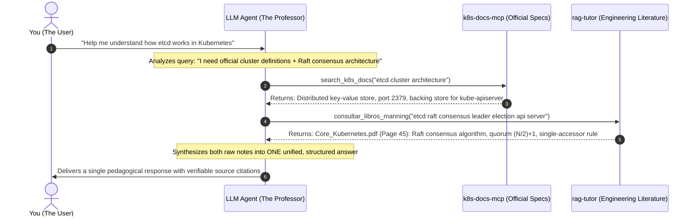

# Multi-MCP 101: How AI Agents Coordinate Multiple Tools (A Practical Guide) 📖

A beginner-friendly, practical guide explaining how autonomous AI coding assistants (Claude Desktop, Cursor, Antigravity, VS Code) coordinate multiple **Model Context Protocol (MCP)** servers to answer complex technical questions without hallucinations.

---

## 1. The Intuitive Mental Model: The Professor & The 3 Desk Books

When you connect multiple MCP servers to an AI agent, how does it work?

Think of it using this simple analogy:

> **The AI Assistant (Claude, Cursor, Antigravity, or Ollama) is the PROFESSOR.**  
> The MCP servers are **three different reference books sitting on the professor's desk**:
> 
> 1. **`study-cybercirujas`**: The **Official Course Syllabus & Exam Curriculum** (exam domains, weights, lab exercises).
> 2. **`k8s-docs-mcp`**: The **Manufacturer's Official Specification Manual** (`kubernetes.io` docs, active/deprecated API versions, byte-exact YAMLs).
> 3. **`rag-tutor`**: The **Advanced Engineering Encyclopedia** (deep platform patterns, Manning books, and KùzuDB GraphRAG).

The MCP servers **do not talk to each other**. They are independent toolboxes. The **Professor (the LLM Agent)** reads your question, decides which book(s) to open, takes notes from them in the background, and drafts a single, cohesive answer for you.

---

## 2. How Does the Agent Decide Where to Go? (Does It Always Call All Three?)

**NO, it does NOT always call all three.**  
Calling every server for every question would be slow, wasteful, and pollute the context window.

The agent decides which tools to invoke based on **Intent Classification**—it compares your prompt against the **tool descriptions (docstrings)** exposed by each server:

| If You Ask... | The Agent Analyzes the Intent: | Which MCP Does It Call? |
| :--- | :--- | :--- |
| *"What is the current apiVersion of NetworkPolicy in Kubernetes 1.31?"* | *"This is a pure syntax and API version check."* | **Only calls `k8s-docs-mcp`** (responds in < 20 ms; does not touch books or exams). |
| *"What topics are tested on the CKA exam regarding etcd?"* | *"This is a question about an official certification curriculum."* | **Only calls `study-cybercirujas`** (retrieves CKA Domain 2.1 objectives). |
| *"How does loose coupling between microservices affect network latency?"* | *"This is theoretical system design and architecture."* | **Only calls `rag-tutor`** (retrieves chapters from engineering books). |
| *"Help me understand how etcd works in Kubernetes."* | *"This is a comprehensive question requiring official specifications AND deep internal architecture."* | **Calls BOTH `k8s-docs-mcp` AND `rag-tutor`** (combines official docs + Raft consensus theory). |

---

## 3. Real Walkthrough: *"Help me understand how etcd works in Kubernetes"*

Here is the exact step-by-step sequence that happens behind the scenes when you submit that prompt:



---

## 4. Who Assembles the Final Response? One Answer or Multiple Answers?

**The agent delivers ONE SINGLE, unified response.**  
It does **NOT** spit out separate *"Response from MCP 1"* and *"Response from MCP 2"*.

The agent uses the retrieved fragments as research notes:
- From the official manual (`k8s-docs-mcp`), it takes the verified facts: port numbers, configuration flags, and the role of etcd as the sole state store.
- From the engineering books (`rag-tutor`), it takes the explanatory mental models: how the Raft consensus algorithm avoids *split-brain* scenarios and why clusters require odd numbers of nodes (3 or 5).

Then it synthesizes a single, human-readable answer:

```text
etcd is the consistent and highly-available key-value store used as Kubernetes' backing store for all cluster data...

1. High Availability & Raft Consensus:
   etcd uses the Raft consensus algorithm to ensure that all members agree on the state of the cluster.
   To maintain quorum, an etcd cluster requires a majority of nodes: (N/2) + 1. This is why production
   deployments always run an odd number of members (typically 3 or 5)...

2. The Single-Accessor Principle:
   As detailed in Kubernetes architecture literature, no cluster component communicates directly with etcd
   except the kube-apiserver. All other controllers, schedulers, and kubelets query state through the API server...

-----------------------------------------------------------------
📖 Consulted Sources:
  • k8s-docs-mcp MCP: kubernetes.io (etcd Cluster Administration)
  • Core_Kubernetes.pdf (Page 45)
-----------------------------------------------------------------
```

---

## 5. How to Use It in Daily Practice

You have two practical ways to use this ecosystem:

### Option A: The Daily Chat Workflow (Claude Desktop, Cursor, Antigravity)
This is the most common and intuitive way to work:
1. Add the MCP servers to your client configuration (`claude_desktop_config.json` or `.cursor/mcp.json`).
2. You do **not** need to memorize special commands or tool names.
3. Simply type your question in natural language:
   > *"What is a ValidatingAdmissionPolicy and how does it compare to admission webhooks?"*
4. Your AI assistant automatically selects the right tools in the background, fetches the verified facts, and answers you with citations.

### Option B: The Automated Study Pipeline (Terminal / Script)
If you are preparing for a CNCF certification or running batch evaluations, you can execute the end-to-end orchestration pipeline directly:

```bash
# Runs the full Tri-MCP sequence (study-cybercirujas + k8s-docs-mcp + rag-tutor)
python test_multi_mcp_live.py
```

This script automates the full **Progressive Grounding Pipeline**:
1. Pulls the exact certification objective and weight from `study-cybercirujas`.
2. Validates the API release and extracts the canonical YAML manifest from `k8s-docs-mcp`.
3. Synthesizes deep architectural trade-offs with book citations from `rag-tutor`.

---

## 6. Summary Checklist: Why This Prevents Hallucinations

| Problem | Naive LLM Behavior | Tri-MCP Sovereign Behavior |
| :--- | :--- | :--- |
| **Kubernetes YAML** | Hallucinates deprecated versions or bad indentation. | **`k8s-docs-mcp`** extracts raw, byte-exact YAML in < 20 ms. |
| **API Deprecations** | Guesses based on outdated training data. | **`k8s-docs-mcp`** checks official OpenAPI v3 schema deterministically. |
| **Architecture & Trade-offs** | Generates generic, superficial buzzwords. | **`rag-tutor`** retrieves specific page-numbered explanations and KùzuDB graph relationships. |
| **Exam Relevance** | Rambles about topics not tested on the exam. | **`study-cybercirujas`** bounds the response strictly to the official syllabus. |
