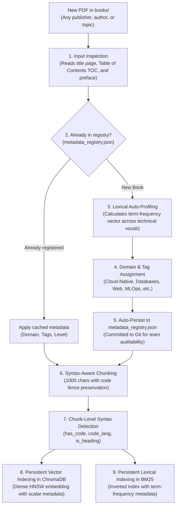

# Universal Metadata Engine & Automated Book Cataloging

This document explains the **deterministic classification and auto-profiling engine** of `rag-tutor`.

It details how the system is capable of ingesting **any technical book** (regardless of vendor, publisher, or subject) without manual tagging, how it automatically populates metadata from scratch, and how it unlocks ultra-precise filtered retrieval.

---

## 1. Design Philosophy: Zero-Config & Absolute Determinism

Historically, classifying technical libraries in RAG systems forced two flawed compromises:
- **Manual tagging:** Slow, tedious, brittle, and error-prone.
- **LLM-based auto-tagging:** Expensive in latency/tokens, non-deterministic (the model invents different taxonomies across runs), and dependent on cloud APIs.

`rag-tutor` implements a third approach: **Deterministic Lexical and Syntactic Auto-Profiling**.

```
┌─────────────────────────────────────────────────────────────────────────────┐
│                           SYSTEM DESIGN PRINCIPLES                          │
│                                                                             │
│  1. Zero-Config     ➜ Drop any PDF into books/ and it processes itself.     │
│  2. Deterministic   ➜ 100% reproducible pattern-matching and syntax rules.  │
│  3. Topic-Agnostic  ➜ Works with any technical book across any domain.      │
│  4. User-Extensible ➜ Declaratively customized via metadata_registry.json.  │
│  5. Accelerated     ➜ ChromaDB scalar pre-filtering before distance math.  │
└─────────────────────────────────────────────────────────────────────────────┘
```

---

## 2. Step-by-Step Workflow: How Metadata Is Populated from Scratch

When you clone the repository empty and place your PDF books into `books/`, the ingestion command (`python src/ingest.py`) executes this deterministic cascade:



---

## 3. Does It Work for Any Technical Book? (Practical Examples)

**Yes. The engine is completely universal for software engineering, cloud infrastructure, systems design, and computer science.**

Here is what happens when you drop in books across diverse disciplines:

---

### Example 1: Database & Storage Engine Books
*E.g., PostgreSQL, Redis, Distributed Data Systems, Designing Data-Intensive Applications.*

1. **Document Auto-Profiling:**
   - Detects high frequency of domain keywords: `sql`, `acid`, `transaction`, `wal`, `replication`, `query planner`, `btree`, `partitioning`.
   - **Assigned Domain:** `databases_and_storage`.
   - **Assigned Tags:** `["databases", "sql", "transactions", "storage_engines"]`.
2. **Chunk-Level Syntax Detection:**
   - Any paragraph containing `SELECT`, `CREATE TABLE`, `EXPLAIN ANALYZE`, or `JOIN` is automatically marked:
     - `has_code = true`
     - `code_lang = "sql"`
3. **Querying It:**
   ```bash
   # Scoped exclusively to storage and database engines
   python src/cli.py "Explain Serializable vs Snapshot isolation" --domain databases_and_storage
   
   # Or retrieving purely executable SQL queries:
   python src/cli.py "Give me an example of a recursive CTE" --code sql
   ```

---

### Example 2: Frontend & Modern Web Architecture Books
*E.g., React, TypeScript, Vue, Next.js, Browser Internals.*

1. **Document Auto-Profiling:**
   - Dominant vocabulary in TOC/preface: `component`, `hook`, `dom`, `state`, `typescript`, `interface`, `render`, `props`.
   - **Assigned Domain:** `web_and_frontend`.
   - **Assigned Tags:** `["typescript", "react", "frontend", "ui_architecture"]`.
2. **Chunk-Level Syntax Detection:**
   - Chunks with `const [state, setState] = useState()`, `interface UserProps`, or `import React`:
     - `has_code = true`
     - `code_lang = "typescript"`
3. **Querying It:**
   ```bash
   python src/cli.py "Explain useEffect vs useLayoutEffect execution order" --code typescript
   ```

---

### Example 3: Systems Programming & Low-Level Architecture Books
*E.g., Rust, Linux Kernel Internals, C/C++, Concurrency.*

1. **Document Auto-Profiling:**
   - Dominant vocabulary: `ownership`, `borrowing`, `lifetime`, `kernel`, `syscall`, `memory safety`, `threads`.
   - **Assigned Domain:** `systems_programming`.
   - **Assigned Tags:** `["rust", "memory_management", "concurrency", "low_level"]`.
2. **Chunk-Level Syntax Detection:**
   - Chunks containing `fn main()`, `impl<T>`, `match`, `unsafe`, or `Arc<Mutex<T>>`:
     - `has_code = true`
     - `code_lang = "rust"`
3. **Querying It:**
   ```bash
   python src/cli.py "How to implement a thread pool with mpsc channels" --domain systems_programming --code rust
   ```

---

### Example 4: Cybersecurity & Ethical Hacking Books
*E.g., API Security, Pentesting, Applied Cryptography, DevSecOps.*

1. **Document Auto-Profiling:**
   - Dominant vocabulary: `vulnerability`, `exploit`, `owasp`, `jwt`, `authentication`, `tls`, `xss`, `csrf`, `injection`.
   - **Assigned Domain:** `devsecops_and_security`.
   - **Assigned Tags:** `["security", "owasp", "cryptography", "hardening"]`.
2. **Chunk-Level Syntax Detection:**
   - Terminal snippets with `curl`, `nmap`, HTTP headers, or security manifests:
     - `has_code = true`
     - `code_lang = "bash"` or `"json"`
3. **Querying It:**
   ```bash
   python src/cli.py "Explain Broken Object Level Authorization (BOLA) risks" --domain devsecops_and_security
   ```

---

### Example 5: Uncataloged or Atypical Books
*What happens if you drop a book on Computational Biology, Discrete Mathematics, or Quantitative Finance?*

1. **Graceful Fallback Mechanism:**
   - If no predefined domain pattern crosses the affinity threshold, the system **never crashes or stalls**.
   - It assigns the universal fallback domain: `general_technical`.
   - It extracts the **top 5 highest TF-IDF terms** from the TOC to auto-generate specific tags.
   - Micro-level chunk syntax detection remains 100% functional, recognizing Python code, C++, Bash scripts, formulas, or pseudocode.

---

## 4. Chunk-Level Syntax Detection (Agnostic to Book Titles)

While document profiling captures the *macro-subject of the book*, the chunk detector captures the *technical purpose of each paragraph*.

It operates by inspecting language signatures and markdown code fences:

| Language / Format | Detected Syntax Signatures | `code_lang` Value |
| :--- | :--- | :---: |
| **YAML / K8s Manifests** | ```` ```yaml ````, `apiVersion:`, `kind:`, `metadata:`, `spec:` | `"yaml"` |
| **Go** | ```` ```go ````, `package main`, `func (`, `type ... struct`, `import (` | `"go"` |
| **Python** | ```` ```python ````, `def `, `class `, `import `, `from ... import` | `"python"` |
| **Bash / Shell** | ```` ```bash ````, `kubectl `, `docker `, `curl `, `chmod `, `export ` | `"bash"` |
| **SQL** | ```` ```sql ````, `SELECT `, `CREATE TABLE `, `WHERE `, `JOIN ` | `"sql"` |
| **TypeScript / JS** | ```` ```ts ````, `interface `, `type `, `const `, `export default` | `"typescript"` |
| **Rust** | ```` ```rust ````, `fn `, `impl `, `pub struct `, `let mut ` | `"rust"` |
| **Terraform / HCL** | ```` ```hcl ````, `resource "`, `variable "`, `provider "` | `"terraform"` |
| **JSON** | ```` ```json ````, `{\n  "`, `": "` | `"json"` |
| **Prose / Theory** | No code fences or syntax keywords | `"none"` |

---

### 4.1 Universal Video Courses, Hands-On Exercises & Subtitles (`.vtt`, `.srt`, Markdown)

`rag-tutor` automatically detects whether an ingested source is a **written technical book** or a **multimedia video course**:

- **Macro-Level Profiling (`content_type`)**: Detects course syllabi, module breakdowns, and video lecture transcripts, setting `"content_type": "video_course"` vs `"book"`.
- **Hands-On Exercises Detection**: Detects coding labs, hands-on demos, and practice quizzes, flagging `"has_exercises": true` and appending `"hands_on_labs"` to tags.
- **Sentence-Aligned Micro-Timestamps**: When ingesting raw WebVTT (`.vtt`), SubRip (`.srt`), or timestamped transcripts, it extracts exact time ranges `[MM:SS - MM:SS]`.
- **Grounded Video Citations**: When the RAG engine or MCP server cites a video lesson, citations automatically pinpoint the lesson and minute range:
  `hugging-face-in-action-video-edition [2025] (Chapter 1. Hugging Face Gradio Python library @ [01:50 - 02:57])`

---

## 5. The `metadata_registry.json` File

The auto-generated configuration file follows this standard declarative schema:

```json
{
  "domains": [
    "cloud_native",
    "platform_engineering",
    "ai_agents",
    "mlops",
    "databases_and_storage",
    "web_and_frontend",
    "systems_programming",
    "devsecops_and_security",
    "distributed_systems",
    "general_technical"
  ],
  "catalog": {
    "Document_A.pdf": {
      "domain": "cloud_native",
      "tags": ["kubernetes", "controllers", "crds"],
      "auto_generated": true,
      "pages": 312
    },
    "Document_B.pdf": {
      "domain": "ai_agents",
      "tags": ["reasoning", "react", "langgraph"],
      "auto_generated": true,
      "pages": 336
    }
  }
}
```

### Key Benefits & How to Update / Override Categories If Needed:
1. **Zero-Touch Autonomy:** If `metadata_registry.json` does not exist, `python src/ingest.py` creates it automatically, assigning primary `domain`, `secondary_domains` (for cross-disciplinary books like *Generative AI on Kubernetes* that span `cloud_native` and `mlops`), `tags` (plural-tolerant), `publication_year`, and the `sections` tree.
2. **How to Inspect Categories & Sections from the CLI:**
   ```bash
   python src/cli.py --list-books
   ```
3. **How to Update / Override Categories If One Is Wrong (2 Ways):**
   - **Method A — Via CLI (1 command, automatic persistence):**
     ```bash
     python src/cli.py \
       --set-book "building-ai-agents-with-llms-rag-and-knowledge-graphs" \
       --set-domain ai_agents \
       --set-tags "agent,llm,rag,knowledge_graph,mlops" \
       --set-year 2025
     ```
     This automatically sets `"auto_generated": false` in `metadata_registry.json` so future runs of `python src/ingest.py` **never overwrite your manual customization**.
   - **Method B — Editing `metadata_registry.json` directly:**
     Open `metadata_registry.json`, change `"domain"`, `"tags"`, or `"publication_year"`, and set `"auto_generated": false`. Then run `python src/ingest.py --force` if you want ChromaDB and BM25 chunks to re-sync with your updated metadata.
4. **Version Control Friendly:** Can be committed to Git so your entire team shares identical search filters.

---

## 6. Scaling to 100+ Books in MCP Without Burning Context Tokens (SQL-Style `WHERE` Filtering)

When an AI agent (Claude, Cursor, Antigravity, Open WebUI) connects via MCP to a library of **100+ technical books**, returning full books or unfiltered chunks quickly exhausts the context window and mixes outdated APIs with modern ones.

To solve this, `rag-tutor` separates responsibility across **3 architectural layers**:

```
┌──────────────────────────────────────────────────────────────────────────────────────┐
│ LAYER 1: METADATA ENGINE (At Ingestion Time - `src/metadata_engine.py`)              │
│ • Extracts `publication_year` (Copyright © YYYY, Publication Date, Edition)          │
│ • Classifies `domain` (cloud_native, mlops, ai_agents, databases_and_storage, etc.)  │
│ • Extracts `tags` (kubernetes, vllm, rag, inference, helm, prometheus, etc.)         │
│ • Builds hierarchical `sections` tree (Chapter -> H2/H3 topics)                      │
│ • Tags every chunk with `section_title`, `has_code`, `code_lang`, `publication_year` │
├──────────────────────────────────────────────────────────────────────────────────────┤
│ LAYER 2: RETRIEVER & MCP TOOLS (`WHERE` Pre-Filtering - `src/mcp_server.py`)         │
│ • `listar_libros_y_secciones(domain, min_year, tag)`:                                │
│     Returns ONLY the compact catalog & chapter tree (~300 tokens instead of 5M).     │
│ • `buscar_fragmentos_secciones(consulta, min_year, domain, tag, seccion, code_lang)`:│
│     Executes SQL-like `WHERE` pre-filtering in ChromaDB + BM25 + Cross-Encoder:      │
│     WHERE publication_year >= 2024 AND domain = 'cloud_native' AND tag LIKE '%vllm%' │
├──────────────────────────────────────────────────────────────────────────────────────┤
│ LAYER 3: AGENT SKILL / SYSTEM PROMPT (Decision Policy)                               │
│ • Instructs the agent:                                                               │
│   1) Call `listar_libros_y_secciones` first to check book years and chapter names.   │
│   2) Pass `min_year=2024` (or `2025` for LLM/K8s topics) + `domain` + `tag`/`seccion`│
│      into `buscar_fragmentos_secciones` to retrieve only 3-4 surgical chunks.        │
└──────────────────────────────────────────────────────────────────────────────────────┘
```

---

## 7. Running and Testing Without an LLM (No Ollama Required)

All metadata profiling, hybrid retrieval (ChromaDB + BM25), Cross-Encoder reranking (`ms-marco-MiniLM-L-6-v2`), and KùzuDB Cypher graph traversal work **100% deterministically without requiring a local LLM (Ollama)**.

### A. CLI in `--no-llm` (`--retrieve-only`) Mode
```bash
# Query with WHERE filters without needing Ollama running:
python src/cli.py "How to serve LLMs with vLLM on Kubernetes?" \
  --no-llm \
  --domain cloud_native \
  --min-year 2025 \
  --tag kubernetes \
  --section "Chapter 3"

# Extract only YAML manifests from books published in 2024+:
python src/cli.py "apiVersion apps/v1 kind Deployment" \
  --no-llm \
  --code yaml \
  --min-year 2024
```

### B. Python API (`tutor.retrieve_only`)
```python
from src.core import AgenticTutorCore

tutor = AgenticTutorCore()
result = tutor.retrieve_only(
    "vLLM GPU deployment on Kubernetes",
    top_k=3,
    domain="cloud_native",
    min_year=2025,
    tag="kubernetes",
    section="Deploying Models",
)
for chunk in result["chunks"]:
    print(chunk.to_citation(), chunk.score)
```

### C. Automated End-to-End Test Suite (Zero LLM Dependency)
```bash
python tests/test_no_llm_pipeline.py
```

---

## 8. Summary of Benefits

| Feature | Standard Naive RAG | RAG Tutor Universal Metadata |
| :--- | :--- | :--- |
| **Multi-Format Input** | PDFs only. | `.pdf`, `.md` folders, `.txt`, `.json`, `.jsonl` (skips `.epub` / `.xhtml` duplicates). |
| **Obsolescence Control** | Mixes 2018 deprecated APIs with 2026 specs. | Auto-detects `publication_year` and filters via `--min-year` / `min_year`. |
| **MCP Token Efficiency** | Dumps massive chunks into agent context. | Progressive section index + `WHERE` filters (`domain`, `tag`, `section`, `code_lang`). |
| **LLM-Free Verification** | Crashes if Ollama/OpenAI is offline. | `--no-llm` CLI flag, `retrieve_only()` API, and `tests/test_no_llm_pipeline.py`. |
