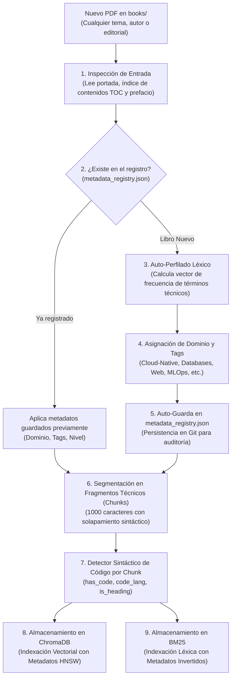

# Sistema de Metadatos y Clasificación Automática de Libros

Este documento describe el funcionamiento del motor de **clasificación determinista y auto-catalogación** de `rag-tutor`. 

Explica cómo el sistema es capaz de ingerir **cualquier tipo de libro técnico** (no solo de una editorial o tema específico) sin configuración manual, cómo auto-popula los metadatos desde cero y cómo habilita búsquedas filtradas ultra-precisas.

---

## 1. Filosofía de Diseño: Zero-Config y Determinismo Absoluto

Tradicionalmente, clasificar bibliotecas técnicas en sistemas RAG requería dos caminos imperfectos:
- **Etiquetado manual:** Lento, tedioso y propenso a errores humanos.
- **Auto-tagging con LLMs:** Costoso en tiempo/tokens, no determinista (el LLM puede inventar categorías distintas cada vez) y dependiente de modelos externos.

`rag-tutor` implementa un tercer camino: **Auto-Perfilado Léxico y Sintáctico Determinista**.

```
┌─────────────────────────────────────────────────────────────────────────────┐
│                          PRINCIPIOS DEL SISTEMA                             │
│                                                                             │
│  1. Zero-Config     ➜ Arrastras cualquier PDF a books/ y corre solo.        │
│  2. Determinista    ➜ Reglas y patrones reproducibles al 100%.             │
│  3. Agnóstico       ➜ Funciona con cualquier libro técnico de cualquier tema│
│  4. Extensible      ➜ Modificable mediante metadata_registry.json en Git.   │
│  5. Acelerador      ➜ Pre-filtrado en ChromaDB antes de computar vectores.  │
└─────────────────────────────────────────────────────────────────────────────┘
```

---

## 2. El Proceso Paso a Paso: ¿Cómo se populan los datos si arrancas vacío?

Cuando clonas el repositorio desde cero y agregas libros a la carpeta `books/`, el comando de ingesta (`python src/ingest.py`) ejecuta el siguiente flujo en cascada:



---

## 3. ¿Sirve para todo tipo de libros? (Ejemplos Prácticos)

**Sí, el sistema es universal para cualquier libro de ingeniería de software, arquitectura o ciencias de la computación.**

A continuación se ilustra qué ocurre cuando ingresas libros de temáticas completamente diversas:

---

### Ejemplo 1: Un libro de Bases de Datos y Almacenamiento
*Imagina que agregas un libro sobre PostgreSQL, Redis o diseño de sistemas distribuidos de datos (ej. Designing Data-Intensive Applications).*

1. **Auto-Perfilado del Libro:**
   - El analizador encuentra alta frecuencia de términos como: `sql`, `acid`, `transaction`, `wal`, `replication`, `query planner`, `btree`, `partitioning`.
   - **Dominio asignado automáticamente:** `databases_and_storage`.
   - **Tags asignados:** `["databases", "sql", "transactions", "storage_engines"]`.
2. **Auto-Detección Sintáctica en Fragmentos:**
   - Un fragmento que contenga `SELECT`, `CREATE TABLE`, `EXPLAIN ANALYZE` o `JOIN` se etiqueta automáticamente como:
     - `has_code = true`
     - `code_lang = "sql"`
3. **¿Cómo puedes consultarlo?**
   ```powershell
   # Consulta acotada exclusivamente al motor de bases de datos
   python src/cli.py "Explica el aislamiento Serializable vs Snapshot" --domain databases_and_storage
   
   # O pedir únicamente consultas SQL:
   python src/cli.py "Dame un ejemplo de CTE recursivo" --code sql
   ```

---

### Ejemplo 2: Un libro de Frontend y Web
*Imagina que agregas un libro de React, TypeScript, Vue o arquitectura de navegadores.*

1. **Auto-Perfilado del Libro:**
   - Palabras dominantes en las primeras 5 páginas: `component`, `hook`, `dom`, `state`, `typescript`, `interface`, `render`, `props`.
   - **Dominio asignado automáticamente:** `web_and_frontend`.
   - **Tags asignados:** `["typescript", "react", "frontend", "ui_architecture"]`.
2. **Auto-Detección Sintáctica en Fragmentos:**
   - Fragmentos con `const [state, setState] = useState()`, `interface UserProps`, `import React` reciben:
     - `has_code = true`
     - `code_lang = "typescript"`
3. **¿Cómo puedes consultarlo?**
   ```powershell
   python src/cli.py "Explica la diferencia entre useEffect y useLayoutEffect" --code typescript
   ```

---

### Ejemplo 3: Un libro de Programación de Sistemas / Rust
*Imagina que agregas un libro sobre programación de bajo nivel, Linux internals o Rust.*

1. **Auto-Perfilado del Libro:**
   - Palabras dominantes: `ownership`, `borrowing`, `lifetime`, `kernel`, `syscall`, `memory safety`, `threads`.
   - **Dominio asignado automáticamente:** `systems_programming`.
   - **Tags asignados:** `["rust", "memory_management", "concurrency", "low_level"]`.
2. **Auto-Detección Sintáctica en Fragmentos:**
   - Fragmentos con `fn main()`, `impl<T>`, `match`, `unsafe` o `Arc<Mutex<T>>`:
     - `has_code = true`
     - `code_lang = "rust"`
3. **¿Cómo puedes consultarlo?**
   ```powershell
   python src/cli.py "Cómo implementar un pool de hilos con canales mpsc" --domain systems_programming --code rust
   ```

---

### Ejemplo 4: Un libro de Ciberseguridad / Ethical Hacking
*Imagina que agregas un libro sobre pentesting, seguridad de APIs o criptografía aplicada.*

1. **Auto-Perfilado del Libro:**
   - Palabras dominantes: `vulnerability`, `exploit`, `owasp`, `jwt`, `authentication`, `tls`, `xss`, `csrf`, `injection`.
   - **Dominio asignado automáticamente:** `devsecops_and_security`.
   - **Tags asignados:** `["security", "owasp", "cryptography", "hardening"]`.
2. **Auto-Detección Sintáctica en Fragmentos:**
   - Fragmentos con comandos de `curl`, `nmap`, encabezados HTTP o políticas de seguridad reciben:
     - `has_code = true`
     - `code_lang = "bash"` o `"json"`
3. **¿Cómo puedes consultarlo?**
   ```powershell
   python src/cli.py "Explica los riesgos de Broken Object Level Authorization (BOLA)" --domain devsecops_and_security
   ```

---

### Ejemplo 5: Un libro completamente nuevo o atípico
*¿Qué ocurre si agregas un libro de Biología Computacional, Matemáticas Discretas o Finanzas Cuantitativas?*

1. **Mecanismo de Contingencia (Fallback Inteligente):**
   - Si ninguna regla temática preexistente supera el umbral de afinidad, el sistema **no falla ni se detiene**.
   - Asigna el dominio universal: `general_technical`.
   - Extrae los **5 términos con mayor peso TF-IDF** del índice de contenidos para crear sus `tags` de forma automática.
   - La detección de código por fragmento (Mecanismo Sintáctico) sigue operando al 100%, detectando fórmulas, snippets en Python, C++, R o pseudocódigo.

---

## 4. Clasificación Sintáctica por Fragmento (Agnóstica al Libro)

Mientras que el dominio clasifica la *temática general del libro*, el detector sintáctico clasifica la *función técnica de cada párrafo*. 

Funciona mediante reconocimiento de firmas y fences de markdown:

| Lenguaje / Formato | Firmas Sintácticas Detectadas | Valor de `code_lang` |
| :--- | :--- | :---: |
| **YAML / K8s Manifests** | ```` ```yaml ````, `apiVersion:`, `kind:`, `metadata:`, `spec:` | `"yaml"` |
| **Go** | ```` ```go ````, `package main`, `func (`, `type ... struct`, `import (` | `"go"` |
| **Python** | ```` ```python ````, `def `, `class `, `import `, `from ... import` | `"python"` |
| **Bash / Shell** | ```` ```bash ````, `kubectl `, `docker `, `curl `, `chmod `, `export ` | `"bash"` |
| **SQL** | ```` ```sql ````, `SELECT `, `CREATE TABLE `, `WHERE `, `JOIN ` | `"sql"` |
| **TypeScript / JS** | ```` ```ts ````, `interface `, `type `, `const `, `export default` | `"typescript"` |
| **Rust** | ```` ```rust ````, `fn `, `impl `, `pub struct `, `let mut ` | `"rust"` |
| **Terraform / HCL** | ```` ```hcl ````, `resource "`, `variable "`, `provider "` | `"terraform"` |
| **JSON** | ```` ```json ````, `{\n  "`, `": "` | `"json"` |
| **Solo Texto / Teoría** | Sin bloques de código ni firmas de lenguajes | `"none"` |

---

## 5. El Archivo `metadata_registry.json`

El archivo de configuración tiene esta estructura declarativa estándar:

```json
{
  "domains": [
    "cloud_native",
    "platform_engineering",
    "ai_agents",
    "mlops",
    "databases_and_storage",
    "web_and_frontend",
    "systems_programming",
    "devsecops_and_security",
    "distributed_systems",
    "general_technical"
  ],
  "catalog": {
    "Documento_A.pdf": {
      "domain": "cloud_native",
      "tags": ["kubernetes", "controllers", "crds"],
      "auto_generated": true,
      "pages": 312
    },
    "Documento_B.pdf": {
      "domain": "ai_agents",
      "tags": ["reasoning", "react", "langgraph"],
      "auto_generated": true,
      "pages": 336
    }
  }
}
```

### Ventajas de este archivo:
1. **Autonomía:** Si el archivo no existe, `python src/ingest.py` lo crea solo.
2. **Personalización:** Si quieres renombrar un tag o forzar un libro a otra categoría, simplemente editas el valor en el JSON; el sistema respetará tu cambio en las siguientes ejecuciones.
3. **Control de Versiones:** Puede ser commiteado en Git para que todo tu equipo comparta exactamente los mismos filtros de búsqueda.

---

## 6. Resumen de Beneficios

| Aspecto | Sin Metadatos | Con el Sistema de Metadatos de rag-tutor |
| :--- | :--- | :--- |
| **Búsqueda de Código** | Recupera párrafos teóricos mezclados con código. | Filtra exclusivamente fragmentos con `has_code=True` y `code_lang="yaml"`. |
| **Palabras Polisémicas** | "Pipeline" confunde CI/CD con MLOps y Streaming. | `domain="cloud_native"` aísla el contexto deseado al 100%. |
| **Escalabilidad** | Escanea 25k+ fragmentos en cada búsqueda. | ChromaDB pre-filtra por metadatos reduciendo el espacio de búsqueda a < 5k fragmentos. |
| **Trabajo del Usuario** | Ninguno. | **Ninguno** (el auto-perfilado y detector sintáctico se ejecutan solos). |
