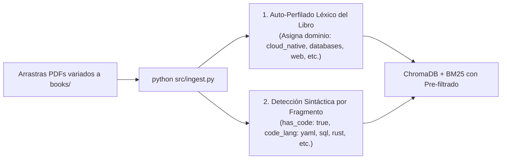

# Manning Platform Engineering Tutor (rag-tutor)

Tutor de Inteligencia Artificial Local especializado en libros técnicos de Manning (Ingeniería de Plataformas, Kubernetes Internals, Operadores en Go, Crossplane y Arquitecturas Cloud-Native).

Implementa una **arquitectura híbrida (Vectorial + BM25 con Reranker)**, un **loop de razonamiento agéntico liviano** y **exposición dual (Servidor MCP + API REST)**, diseñada de forma desacoplada para evolucionar iterativamente hacia **Omnigraph (GraphRAG)**.

Consulta el documento de decisiones en [ARCHITECTURE.md](ARCHITECTURE.md), el motor de metadatos en [METADATA_SYSTEM.md](METADATA_SYSTEM.md), la integración con certificaciones en [CERTIFICATION_TUTOR_MCP.md](CERTIFICATION_TUTOR_MCP.md), la declaración de IA y guardrails en [AI_DISCLOSURE_AND_GUARDRAILS.md](AI_DISCLOSURE_AND_GUARDRAILS.md) y las pruebas reales en [VERIFICATION_TESTS.md](VERIFICATION_TESTS.md).

---

## Estructura del Proyecto

```text
rag-tutor/
├── books/                     # Carpeta con tus libros PDF de Manning
│   └── .gitkeep
├── chroma_db/                 # Base de datos vectorial persistente (ChromaDB)
├── bm25_index.pkl             # Índice léxico BM25 para nombres exactos de YAML/Go
├── knowledge_graph.json       # Grafo ontológico de conceptos y relaciones (Fase 2)
├── docker-compose.yml         # Contenedor opcional para servicio daemon de Omnigraph
├── src/
│   ├── __init__.py
│   ├── config.py              # Parámetros centralizados y selector de motor
│   ├── core.py                # Tutor Core con loop agéntico de auto-reflexión
│   ├── cli.py                 # Cliente de consola interactivo y de comandos
│   ├── ingest.py              # Ingesta de PDFs, chunking técnico e indexación híbrida
│   ├── ingest_graph.py        # Ingesta y generación del grafo ontológico (Fase 2)
│   ├── graph_schema.py        # Esquema de nodos y aristas del Grafo de Conocimiento
│   ├── mcp_server.py          # Servidor Model Context Protocol (FastMCP / MCPServer)
│   ├── api.py                 # API REST FastAPI para interfaces Web / Open WebUI
│   └── retrievers/
│       ├── __init__.py
│       ├── base.py            # Interfaz abstracta BaseRetriever y RetrievedChunk
│       ├── hybrid.py          # Fase 1: ChromaDB + BM25 + Cross-Encoder Reranker
│       └── omnigraph.py       # Fase 2: Conector Omnigraph (Remoto + Local GraphRAG)
├── requirements.txt           # Dependencias de Python
├── ARCHITECTURE.md            # Registro de decisiones de arquitectura y roadmap
├── METADATA_SYSTEM.md         # Motor de metadatos universal y auto-perfilado
├── CERTIFICATION_TUTOR_MCP.md # Integración Open WebUI + MCP con study-cybercirujas
├── AI_DISCLOSURE_AND_GUARDRAILS.md # Transparencia, trazabilidad y guardrails (EU AI Act)
├── VERIFICATION_TESTS.md      # Informe de pruebas empíricas reales reproducibles
├── LICENSE                    # Licencia Apache 2.0 de código abierto
└── README.md
```

---

## Roadmap Iterativo

- [x] **Fase 1 (Fundamento Híbrido)**:
  - Ingesta con chunking optimizado para bloques YAML y Go (4 libros, 1.676 págs, 4.169 fragmentos).
  - Búsqueda híbrida (Chroma semántico + BM25 exacto).
  - Reranking local con Cross-Encoder (`ms-marco-MiniLM-L-6-v2`).
  - Agentic RAG loop (evaluación y profundización en máx. 2 pasos).
  - Servidor MCP compatible con `mcp 2.x` + API FastAPI + CLI interactivo.
- [x] **Fase 2 (GraphRAG / Omnigraph)**:
  - Definición del esquema ontológico (`src/graph_schema.py`) con nodos y aristas de Platform Engineering y AI Agents.
  - Generador de ontología y persistencia en `knowledge_graph.json` (`src/ingest_graph.py`).
  - Conector `OmnigraphRetriever` con soporte dual: consulta remota a daemon Omnigraph vía HTTP o traversal de relaciones en memoria local.
  - Configuración opcional con Docker Compose (`docker-compose.yml`).

---

## Sistema de Metadatos y Clasificación Universal (Zero-Config)

El sistema incorpora un motor de auto-catalogación determinista que permite agregar **cualquier libro técnico** (PostgreSQL, React, Rust, Ciberseguridad, Kubernetes, etc.) sin configuración manual:



1. **Auto-Perfilado en la Ingesta (Zero-Config):** Al colocar nuevos PDFs en `books/` y ejecutar `python src/ingest.py`, el sistema lee la portada y tabla de contenidos (TOC) y asigna automáticamente el dominio temático (`cloud_native`, `databases_and_storage`, `web_and_frontend`, `systems_programming`, `devsecops`, `ai_agents`, `mlops`, `general_technical`), guardándolo en `metadata_registry.json`.
2. **Detección Sintáctica por Fragmento:** Analiza el código dentro de cada fragmento y marca automáticamente si contiene código (`has_code: true`) y su lenguaje exacto (`code_lang: yaml | go | python | sql | rust | bash | typescript`).
3. **Búsquedas Filtradas de Alta Precisión:** Permite al usuario en la CLI, a agentes de IA vía MCP y a clientes HTTP filtrar por dominio y por lenguaje exacto, acelerando la búsqueda y eliminando la dilución semántica.

Consulta la guía técnica con ejemplos prácticos paso a paso en [METADATA_SYSTEM.md](METADATA_SYSTEM.md).

---

## Autenticación Opcional en Hugging Face (HF_TOKEN)

> [!NOTE]
> **El sistema opera 100% en local y offline sin necesidad de iniciar sesión ni crear cuentas.**
> Los modelos de embeddings y reranking ya están descargados en tu caché local (`~/.cache/huggingface/hub`).

Si en algún momento deseas vincular tu cuenta personal de Hugging Face para obtener límites más altos de descarga o utilizar modelos privados:
1. Genera un token gratuito de tipo *Read* en [huggingface.co/settings/tokens](https://huggingface.co/settings/tokens).
2. Configúralo en tu terminal antes de ejecutar:
   ```powershell
   $env:HF_TOKEN = "hf_tu_token_aqui"
   ```
   O mediante el CLI oficial:
   ```powershell
   huggingface-cli login
   ```
Si no defines ningún token, el código suprime automáticamente las advertencias y funciona de forma silenciosa y autónoma.

---

## Requisitos Previos

- **Python**: 3.10 o superior (recomendado 3.11).
- **Ollama**: Con el modelo instalado (ej. `qwen2.5:7b`):
  ```bash
  ollama pull qwen2.5:7b
  ```

---

## Instalación y Configuración

1. **Crear y activar el entorno virtual:**
   ```bash
   python -m venv venv
   # En Windows PowerShell:
   .\venv\Scripts\Activate.ps1
   # En Linux / macOS / WSL:
   source venv/bin/activate
   ```

2. **Instalar dependencias:**
   ```bash
   pip install -r requirements.txt
   ```

3. **Colocar tus libros de Manning:**
   - Copia tus archivos `.pdf` dentro del directorio `books/`.

4. **Ejecutar la Ingesta e Indexación:**
   ```bash
   python src/ingest.py
   ```

---

## Guía Detallada de los Modos de Uso

El tutor puede ser utilizado de tres formas complementarias según tu flujo de trabajo:

---

### Modo 1: Consola / CLI Local (`src/cli.py`)

Diseñado para hacer consultas rápidas desde tu terminal sin necesidad de navegadores ni clientes externos.

#### A. Consulta directa por argumento (en una sola línea)
```powershell
.\.venv\Scripts\python.exe src/cli.py "Explica cómo diseñar un Agente de IA reactivo"
```

#### B. Modo Chat interactivo (bucle continuo)
Si ejecutas el script sin argumentos, entrarás a una sesión interactiva continua:
```powershell
.\.venv\Scripts\python.exe src/cli.py
```
```text
=================================================================
 📚 Manning Platform & AI Tutor (Consola Interactiva)
 Escribe tu consulta técnica o 'salir' / 'exit' para terminar.
=================================================================

> Pregunta:
Explica el concepto de Paved Roads en Platform Engineering

[... genera respuesta técnica y fuentes ...]

> Pregunta:
salir
¡Hasta luego!
```

---

### Modo 2: Servidor MCP - Model Context Protocol (`src/mcp_server.py`)

Permite a clientes de IA en terminal o IDE (como **Claude Desktop**, **Goose CLI**, o **Antigravity**) invocar tu biblioteca de libros como herramientas nativas de llamada a funciones (*function calling*).

#### Iniciar el servidor manualmente:
```powershell
.\.venv\Scripts\python.exe src/mcp_server.py
```

#### Herramientas (Tools) que expone el servidor:
1. `consultar_libros_manning(pregunta: str) -> str`:
   - Realiza la búsqueda semántica e híbrida y activa el loop agéntico de auto-reflexión con Ollama para devolver una respuesta fundamentada con citas de páginas.
2. `buscar_codigo_yaml(termino: str) -> str`:
   - Búsqueda léxica directa para recuperar fragmentos exactos de manifiestos YAML, CRDs, comandos de CLI y snippets de Go sin interpretación del LLM.

#### Integración con Claude Desktop / Goose CLI (`claude_desktop_config.json`):
```json
{
  "mcpServers": {
    "manning-tutor": {
      "command": "C:\\Users\\rino\\Documents\\GitHub\\rag-tutor\\.venv\\Scripts\\python.exe",
      "args": [
        "C:\\Users\\rino\\Documents\\GitHub\\rag-tutor\\src\\mcp_server.py"
      ]
    }
  }
}
```

---

### Modo 3: API REST con FastAPI (`src/api.py`)

Expone el tutor a través de HTTP estándar, permitiendo conectarlo con interfaces web, extensiones, scripts automatizados o **Open WebUI**.

#### Iniciar la API:
```powershell
.\.venv\Scripts\python.exe src/api.py
```
El servidor arrancará en: `http://localhost:8000`

#### Documentación Interactiva (Swagger UI):
Abre en tu navegador:
```text
http://localhost:8000/docs
```
Podrás probar el endpoint `POST /chat` directamente con un clic desde la interfaz visual.

#### Endpoints Disponibles:
- `GET /health`: Verifica el estado de salud del sistema, ChromaDB, BM25 y el modelo de Ollama.
- `POST /chat`: Envía una consulta y recibe la respuesta con fuentes y estadísticas.

#### Ejemplo de consumo con cURL / PowerShell:
```powershell
Invoke-RestMethod -Uri "http://localhost:8000/chat" -Method Post -ContentType "application/json" -Body '{"question": "¿Qué es Crossplane y cómo se relaciona con Platform Engineering?"}'
```

---

## Tecnologías Utilizadas y Repositorios Oficiales

A continuación se detallan las tecnologías de código abierto que componen la arquitectura del proyecto, junto con sus repositorios fuente y su rol en el sistema:

| Tecnología | Repositorio Oficial | Rol en el Proyecto |
| :--- | :--- | :--- |
| **ModernRelay Omnigraph** | [ModernRelay/omnigraph](https://github.com/ModernRelay/omnigraph) | Motor de base de datos de grafos nativo de lakehouse sobre Lance con Git-style branching para estado agéntico y relaciones ontológicas (Fase 2). |
| **Lance** | [lancedb/lance](https://github.com/lancedb/lance) | Formato columnar moderno para datos multimodales y búsqueda vectorial de alto rendimiento utilizado por Omnigraph. |
| **ChromaDB** | [chroma-core/chroma](https://github.com/chroma-core/chroma) | Base de datos vectorial embebida de código abierto para indexación y búsqueda semántica de fragmentos técnicos (Fase 1). |
| **Rank-BM25** | [dorianbrown/rank_bm25](https://github.com/dorianbrown/rank_bm25) | Implementación de algoritmos de búsqueda léxica BM25 (Okapi BM25) para captura exacta de nombres de CRDs, YAMLs y funciones. |
| **Sentence-Transformers** | [UKPLab/sentence-transformers](https://github.com/UKPLab/sentence-transformers) | Framework para computar embeddings densos (`all-MiniLM-L6-v2`) y modelos de Cross-Encoder Reranking (`ms-marco-MiniLM-L-6-v2`). |
| **LangChain Core & Community** | [langchain-ai/langchain](https://github.com/langchain-ai/langchain) | Abstracciones para orquestación de RAG, splitters de texto con preservación de código y loaders de documentos. |
| **PyMuPDF (fitz)** | [pymupdf/PyMuPDF](https://github.com/pymupdf/PyMuPDF) | Extracción ultrarrápida de texto, metadatos y páginas desde libros PDF. |
| **Model Context Protocol (MCP)** | [modelcontextprotocol/python-sdk](https://github.com/modelcontextprotocol/python-sdk) | SDK oficial de Anthropic / Linux Foundation para exponer herramientas a agentes de IA mediante el protocolo MCP (v2.x `MCPServer`). |
| **FastAPI** | [fastapi/fastapi](https://github.com/fastapi/fastapi) | Framework web asíncrono para construir la API REST y documentación interactiva Swagger UI. |
| **Ollama** | [ollama/ollama](https://github.com/ollama/ollama) | Motor de inferencia local de modelos de lenguaje en hardware propio (CPU Xeon / GPU). |
| **Qwen 2.5 (Alibaba)** | [QwenLM/Qwen2.5](https://github.com/QwenLM/Qwen2.5) | Familia de modelos fundacionales de código abierto de última generación utilizados para el razonamiento agéntico y síntesis técnica. |
| **uv (Astral)** | [astral-sh/uv](https://github.com/astral-sh/uv) | Gestor de paquetes y entornos virtuales de Python ultrarrápido escrito en Rust. |

---

## Declaración de IA, Transparencia y Guardrails

El contenido pedagógico y las respuestas sintetizadas por `rag-tutor` son generadas por modelos de lenguaje de gran escala (LLMs) ejecutados localmente. Al igual que en proyectos de educación abierta como [study-cybercirujas](https://github.com/villadalmine/study-cybercirujas):
- El sistema actúa como un **asistente de estudio**; los libros de ingeniería y la documentación oficial de los vendors son la máxima autoridad técnica.
- Se implementan **4 capas de guardrails automáticos** en código: Reranking Cross-Encoder, Loop Agéntico de Auto-Reflexión, Citas Obligatorias de Páginas y Soberanía Local de Datos sin telemetría.
- Cumple con los estándares de trazabilidad y transparencia en alineación con el **Artículo 50 del AI Act de la Unión Europea**.

Consulta la declaración completa en [AI_DISCLOSURE_AND_GUARDRAILS.md](AI_DISCLOSURE_AND_GUARDRAILS.md).

---

## Pruebas de Verificación y Reproducibilidad

Todas las afirmaciones sobre rendimiento, latencia (<350 ms pre-LLM), mitigación de dilución en 23.343 fragmentos y precisión de citas fueron validadas mediante pruebas empíricas reales en hardware local.

Consulta el reporte de ejecución con traza completa y pasos de reproducción en [VERIFICATION_TESTS.md](VERIFICATION_TESTS.md).

---

## Licencia

Este proyecto está bajo la **Licencia Apache 2.0** de código abierto. Consulta el archivo [LICENSE](LICENSE) para más detalles.


