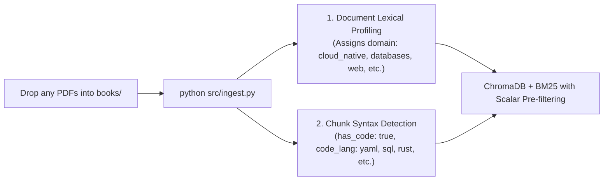

# Universal Technical RAG Tutor (rag-tutor)

Agnostic, sovereign local AI tutor for technical books (Software Engineering, Kubernetes Internals, Databases, Systems Programming in Rust/Go, Platform Engineering, AI Agents, and Cloud-Native Architectures).

> [!IMPORTANT]
> **BYOB (Bring Your Own Books) Philosophy & Universal Applicability:**
> - **You bring your own books:** This repository is a 100% open-source software engine and **does not distribute, host, or bundle copyrighted books**; the `books/` directory is intentionally empty.
> - **Works with ANY technical book:** While the initial reference benchmark was validated with 22 sources covering Cloud-Native and Platform Engineering, the engine is completely agnostic: you can drop in books on **Databases (PostgreSQL, Redis)**, **Frontend (React, TypeScript)**, **Low-level Systems (Rust, Go, C++)**, **Cybersecurity**, **Networking**, or internal engineering handbooks. The system auto-profiles and auto-classifies them on first ingestion.

It implements a **hybrid retrieval architecture (Vector + BM25 with Cross-Encoder Reranker)**, a **lightweight agentic self-reflection loop**, and **dual exposure (MCP Server + REST API)**, architecturally decoupled to iteratively scale into **Omnigraph (GraphRAG)**.

Consult the architectural decision record in [ARCHITECTURE.md](ARCHITECTURE.md), the universal metadata engine in [METADATA_SYSTEM.md](METADATA_SYSTEM.md), the open certifications multi-MCP integration in [CERTIFICATION_TUTOR_MCP.md](CERTIFICATION_TUTOR_MCP.md), the complete live demo runbooks in [DEMO_RUNBOOK_STUDY_OPENWEBUI.md](DEMO_RUNBOOK_STUDY_OPENWEBUI.md) (EN) and [DEMO_RUNBOOK_ES.md](DEMO_RUNBOOK_ES.md) (ES), the real use cases and setup walkthrough in [USE_CASES_AND_EXAMPLES.md](USE_CASES_AND_EXAMPLES.md), the AI disclosure and guardrails in [AI_DISCLOSURE_AND_GUARDRAILS.md](AI_DISCLOSURE_AND_GUARDRAILS.md), and reproducible empirical tests in [VERIFICATION_TESTS.md](VERIFICATION_TESTS.md).

---

## Project Structure

```text
rag-tutor/
├── books/                     # Place your own PDF books here (empty by default)
│   └── .gitkeep
├── chroma_db/                 # Persistent vector database (ChromaDB)
├── bm25_index.pkl             # Inverted BM25 lexical index for exact code tokens
├── knowledge_graph.json       # Ontological graph of concepts and relations (Phase 2)
├── docker-compose.yml         # Optional container for Omnigraph lakehouse daemon
├── src/
│   ├── __init__.py
│   ├── config.py              # Centralized configuration and engine selector
│   ├── core.py                # Agentic Tutor Core with self-reflection loop
│   ├── cli.py                 # Interactive and single-query command-line interface
│   ├── ingest.py              # Incremental PDF ingestion with SHA-256 change detection
│   ├── ingest_graph.py        # GraphRAG knowledge graph ingestion (Phase 2)
│   ├── graph_schema.py        # Schema of nodes and edges for the knowledge graph
│   ├── kuzu_graph.py          # Embedded KùzuDB Cypher query engine for GraphRAG
│   ├── schemas.py             # Pydantic contract schemas for syllabus and external MCPs
│   ├── mcp_server.py          # Model Context Protocol server (FastMCP / MCPServer)
│   ├── api.py                 # FastAPI REST API for Web interfaces / Open WebUI
│   └── retrievers/
│       ├── __init__.py
│       ├── base.py            # Abstract BaseRetriever and RetrievedChunk interfaces
│       ├── hybrid.py          # Phase 1: ChromaDB + BM25 + Cross-Encoder Reranker
│       └── omnigraph.py       # Phase 2: KùzuDB Cypher + Omnigraph connector
├── requirements.txt           # Python dependencies
├── test_multi_mcp_live.py     # Live Tri-MCP verification (study-cybercirujas + k8s-docs-mcp + rag-tutor)
├── DEMO_RUNBOOK_STUDY_OPENWEBUI.md # Live demo runbook: Study platform, Open WebUI, Ollama & Tri-MCP (English)
├── DEMO_RUNBOOK_ES.md         # Guía de demostración completa en español con enlaces interactivos
├── ARCHITECTURE.md            # Architecture Decision Records (ADRs) and roadmap
├── METADATA_SYSTEM.md         # Universal zero-config metadata engine documentation
├── CERTIFICATION_TUTOR_MCP.md # Open WebUI + MCP integration with study-cybercirujas
├── HOW_TO_MULTI_MCP_101.md    # Beginner 101 guide: How agents coordinate multiple MCP servers
├── USE_CASES_AND_EXAMPLES.md  # Step-by-step setup walkthrough and real terminal outputs
├── RESEARCH_AND_LESSONS_LEARNED.md # Multi-MCP orchestration research, challenges & solutions
├── AI_DISCLOSURE_AND_GUARDRAILS.md # Transparency, traceability, and guardrails (EU AI Act)
├── VERIFICATION_TESTS.md      # Empirical verification test report and reproduction steps
├── LICENSE                    # Apache 2.0 Open Source License
└── README.md
```

> [!NOTE]
> **Understanding `knowledge_graph.json` (Seed Ontology Template):**
> `knowledge_graph.json` (~7 KB) is provided as an out-of-the-box **seed ontology template** demonstrating how Phase 2 GraphRAG traverses entities and directional relationships. It contains **zero copyrighted text** (unlike vector embeddings). You are **not required to keep this specific data**: you can freely customize entities in [`src/ingest_graph.py`](src/ingest_graph.py) or regenerate it for your specific engineering domains.

---

## Iterative Roadmap

- [x] **Phase 1 (Hybrid Foundation)**:
  - Code-aware chunking optimized for YAML and Go syntax (verified with 22 sources, 8,516 pages, 23,343 chunks).
  - Hybrid retrieval (Chroma semantic dense search + BM25 exact lexical match).
  - Local reranking via Cross-Encoder (`ms-marco-MiniLM-L-6-v2`).
  - Agentic RAG reflection loop (context sufficiency evaluation in max 2 steps).
  - MCP Server compatible with `mcp 2.x` (`MCPServer`) + FastAPI REST API + interactive CLI.
- [x] **Phase 2 (GraphRAG / KùzuDB / Omnigraph)**:
  - Ontological schema definition (`src/graph_schema.py`) with domain entities and relations.
  - Embedded **KùzuDB Cypher Engine** (`src/kuzu_graph.py`) for sub-millisecond local graph traversals without Docker daemons.
  - Graph generator persisting into `knowledge_graph.json` (`src/ingest_graph.py`).
  - Dual-mode `OmnigraphRetriever` connector: remote HTTP querying to Omnigraph daemon or local in-memory/KùzuDB relationship traversal.
  - Container deployment ready with Docker Compose (`docker-compose.yml`).

---

## Universal Metadata Engine (Zero-Config)

The system features a deterministic auto-cataloging engine that supports **any technical book** (PostgreSQL, React, Rust, Cybersecurity, Kubernetes, etc.) without manual tagging:



1. **Auto-Profiling on Ingestion (Zero-Config):** When you place PDFs in `books/` and run `python src/ingest.py`, the system reads the table of contents (TOC) and initial pages, automatically assigning the domain (`cloud_native`, `databases_and_storage`, `web_and_frontend`, `systems_programming`, `devsecops`, `ai_agents`, `mlops`, `general_technical`), persisting it to `metadata_registry.json`.
2. **Chunk-Level Syntax Detection:** Pure regex analysis checks for code blocks, tagging each chunk with `has_code: true` and its exact language (`yaml | go | python | sql | rust | bash | typescript`).
3. **High-Precision Filtered Retrieval:** Enables CLI users, MCP agents, and HTTP clients to filter by domain and language, eliminating cross-domain noise and accelerating retrieval.

Read the detailed guide with practical examples in [METADATA_SYSTEM.md](METADATA_SYSTEM.md).

---

## Optional Hugging Face Authentication (HF_TOKEN)

> [!NOTE]
> **The system operates 100% locally and offline without requiring accounts or logins.**  
> Embedding and reranking models run from local cache (`~/.cache/huggingface/hub`) under `HF_HUB_OFFLINE=1`.

If you ever wish to connect your personal Hugging Face account for higher download rate limits or private models:
1. Create a free *Read* token at [huggingface.co/settings/tokens](https://huggingface.co/settings/tokens).
2. Set it in your environment:
   ```bash
   export HF_TOKEN="hf_your_token_here"
   ```
   Or via the official CLI:
   ```bash
   huggingface-cli login
   ```
If no token is set, warnings are automatically suppressed and execution runs silently offline.

---

## Prerequisites

- **Python**: 3.10 or higher (3.11 recommended).
- **Ollama**: Running locally with your chosen model (e.g., `qwen2.5:7b`):
  ```bash
  ollama pull qwen2.5:7b
  ```

---

## Installation & Setup

1. **Create and activate a virtual environment:**
   ```bash
   python -m venv .venv
   source .venv/bin/activate
   ```

2. **Install dependencies:**
   ```bash
   pip install -r requirements.txt
   ```

3. **Place your technical books (Any topic / vendor):**
   - Copy your `.pdf` files into the `books/` folder. The system is agnostic and will auto-classify them.

4. **Run ingestion and indexing:**
   ```bash
   python src/ingest.py
   ```
   *(Subsequent runs only process newly added books incrementally).*

---

## Detailed Usage Modes

The tutor can be used in three complementary modes depending on your workflow:

---

### Mode 1: Local Console / CLI (`src/cli.py`)

Fast, zero-overhead terminal queries without requiring a browser or external client.

#### A. Direct query argument (single-line execution)
```bash
python src/cli.py "Explain how to design a reactive AI Agent"
```

#### B. Interactive Chat loop (continuous session)
Run without arguments for an interactive REPL:
```bash
python src/cli.py
```
```text
=================================================================
 📚 Universal Technical AI Tutor (Interactive Console)
 Type your technical query or 'exit' / 'quit' to quit.
=================================================================

> Question:
Explain the concept of Paved Roads in Platform Engineering

[... generates technical synthesis with book citations ...]

> Question:
exit
Goodbye!
```

---

### Mode 2: MCP Server - Model Context Protocol (`src/mcp_server.py`)

Exposes your book library as native function-calling tools to external AI agents in your terminal or IDE (such as **Claude Desktop**, **Goose CLI**, or **Antigravity**).

#### Start the server manually (stdio):
```bash
python src/mcp_server.py
```

#### Exposed Tools:
1. `consultar_libros_manning(pregunta: str) -> str`:
   - Runs hybrid retrieval and triggers the agentic reflection loop with Ollama to return a grounded synthesis with exact page citations.
2. `buscar_codigo_yaml(termino: str) -> str`:
   - Direct lexical retrieval for exact YAML manifests, CRDs, CLI commands, and Go snippets without LLM alteration.

#### Claude Desktop / Goose CLI integration (`claude_desktop_config.json`):
```json
{
  "mcpServers": {
    "rag-tutor": {
      "command": "/path/to/rag-tutor/.venv/bin/python",
      "args": [
        "/path/to/rag-tutor/src/mcp_server.py"
      ]
    }
  }
}
```

---

### Mode 3: REST API with FastAPI (`src/api.py`)

Exposes the tutor over standard HTTP, allowing integration with Web frontends, scripts, or **Open WebUI**.

#### Start the API server:
```bash
python src/api.py
```
Default URL: [http://localhost:8000](http://localhost:8000)

#### Interactive API Documentation (Swagger UI):
Open in your browser:
👉 **[Open Swagger UI (http://localhost:8000/docs)](http://localhost:8000/docs)**
You can test the `POST /chat` endpoint directly from the UI.

#### Available Endpoints:
- `GET /health`: Healthcheck verifying ChromaDB, BM25, and local Ollama model connectivity.
- `GET /mcp/status`: Real-time monitoring and connection status across all 3 MCP servers (`study-cybercirujas`, `k8s-docs-mcp`, `rag-tutor`).
- `POST /mcp/test`: Live diagnostics endpoint with deterministic Kind extraction, stop-word filtering, and multi-manifest retrieval across all connected MCP servers.
- `POST /chat`: Query endpoint returning grounded answers, sources, and pipeline telemetry with optional Tri-MCP enrichment (`orchestrate_tri_mcp: true`).

#### Consumption examples via cURL:

```bash
# Check status of all 3 connected MCP servers:
curl -s http://localhost:8000/mcp/status | jq

# Run diagnostics with natural language query (extracts Pod, pulls 3 canonical manifests, links CKA 3.5):
curl -s -X POST http://localhost:8000/mcp/test \
  -H "Content-Type: application/json" \
  -d '{"target": "all", "query": "three example how i can create a pod yaml definition and a theory how works"}' | jq

# Ask a question with full Tri-MCP orchestration:
curl -s -X POST http://localhost:8000/chat \
  -H "Content-Type: application/json" \
  -d '{"question": "How do in-tree ValidatingAdmissionPolicies work in Kubernetes?", "orchestrate_tri_mcp": true}'
```

> [!TIP]
> Para ver la lista completa de comandos `curl`, validaciones de hardware (GPU vs CPU), guías de integración con Open WebUI y pasos de arranque desde cero, consulta el documento:
> 👉 **[CHEATSHEET_DEMO_COMMANDS.md](CHEATSHEET_DEMO_COMMANDS.md)**

---

## Technologies & Upstream Repositories

| Technology | Official Repository | Role in the Project |
| :--- | :--- | :--- |
| **ModernRelay Omnigraph** | [ModernRelay/omnigraph](https://github.com/ModernRelay/omnigraph) | Lakehouse-native graph database over Lance with Git-style branching for agentic state (Phase 2). |
| **Lance** | [lancedb/lance](https://github.com/lancedb/lance) | Modern columnar format for multimodal data and high-performance vector search. |
| **ChromaDB** | [chroma-core/chroma](https://github.com/chroma-core/chroma) | Embedded open-source vector database for dense indexing and semantic search (Phase 1). |
| **Rank-BM25** | [dorianbrown/rank_bm25](https://github.com/dorianbrown/rank_bm25) | Okapi BM25 lexical search implementation for exact code tokens, CRDs, and keywords. |
| **Sentence-Transformers** | [UKPLab/sentence-transformers](https://github.com/UKPLab/sentence-transformers) | Dense embedding models (`all-MiniLM-L6-v2`) and Cross-Encoder rerankers (`ms-marco-MiniLM-L-6-v2`). |
| **LangChain Core & Community** | [langchain-ai/langchain](https://github.com/langchain-ai/langchain) | RAG orchestration abstractions, code-aware text splitters, and document loaders. |
| **PyMuPDF (fitz)** | [pymupdf/PyMuPDF](https://github.com/pymupdf/PyMuPDF) | High-speed C-based text, metadata, and page extraction from PDF books. |
| **Model Context Protocol (MCP)** | [modelcontextprotocol/python-sdk](https://github.com/modelcontextprotocol/python-sdk) | Official Anthropic / Linux Foundation SDK exposing tools to agents via MCP (v2.x `MCPServer`). |
| **FastAPI** | [fastapi/fastapi](https://github.com/fastapi/fastapi) | Async web framework powering the REST API and interactive Swagger documentation. |
| **Ollama** | [ollama/ollama](https://github.com/ollama/ollama) | Local model inference engine running on consumer hardware (CPU / GPU). |
| **Qwen 2.5 (Alibaba)** | [QwenLM/Qwen2.5](https://github.com/QwenLM/Qwen2.5) | Open-weights foundation models used for agentic reasoning and technical synthesis. |
| **uv (Astral)** | [astral-sh/uv](https://github.com/astral-sh/uv) | High-speed Rust-based Python package manager and resolver. |

---

## AI Disclosure, Transparency & Guardrails

All educational explanations generated by `rag-tutor` are produced by locally executed large language models. In alignment with open educational initiatives like [study-cybercirujas](https://github.com/villadalmine/study-cybercirujas):
- The system functions strictly as a **study aid**; original engineering books and vendor documentation are the ultimate authority.
- The pipeline implements **4 automated mechanical guardrails**: Cross-Encoder Reranking, Agentic Self-Reflection Loop, Mandatory Page Citations, and Sovereign Local Data Privacy.
- Complies with transparency and traceability standards aligned with **EU AI Act Article 50**.

Read the full disclosure and policy in [AI_DISCLOSURE_AND_GUARDRAILS.md](AI_DISCLOSURE_AND_GUARDRAILS.md).

---

## Empirical Verification Tests & Reproducibility

All claims regarding sub-350ms pre-LLM latency, dilution mitigation across 23,343 chunks, and exact page citation fidelity have been empirically validated on local hardware.

Read the execution logs, model telemetry, and reproduction instructions in [VERIFICATION_TESTS.md](VERIFICATION_TESTS.md).

---

## Multi-MCP Research, Architecture & Lessons Learned

For an in-depth analysis of how autonomous agents can coordinate multiple MCP servers (`study-cybercirujas`, `k8s-docs-mcp`, and `rag-tutor`) without tool collisions, context bloat, or hallucinations, consult **[RESEARCH_AND_LESSONS_LEARNED.md](RESEARCH_AND_LESSONS_LEARNED.md)**. It covers:
1. **The Core Multi-MCP Problem:** Why free-wheeling ReAct loops hallucinate and fail in production.
2. **The Separation of Powers Contract:** Semantic boundary allocation between Syllabus, Specification, and Architecture.
3. **Key Implementations:** SHA-256 incremental hashing, embedded KùzuDB Cypher engine, Hugo shortcode preprocessors, and SQLite FTS5 stores.
4. **Behind-the-Scenes Hurdles:** Resolving batch insert limits, UTF-8 Windows stream encoding, and deterministic OpenAPI schema validation.
5. **Research Scope Notice:** Clear framing of this project as an educational proof-of-concept for sovereign information access.

For an intuitive, step-by-step 101 guide explaining how an AI agent decides which MCP to consult (e.g. answering *"How does etcd work in K8s?"* without querying all tools blindly), read **[HOW_TO_MULTI_MCP_101.md](HOW_TO_MULTI_MCP_101.md)**.

---

## Real Use Cases & Terminal Outputs

To see how the engine operates in practice on real hardware, consult **[USE_CASES_AND_EXAMPLES.md](USE_CASES_AND_EXAMPLES.md)**. It documents:
1. **"How I Made It Work" Walkthrough:** From clean virtualenv initialization to handling ChromaDB's 5,461-chunk batch limits with 2,000-chunk slicing during ingestion.
2. **Real Terminal Output 1:** Deep K8s Internals (Mutating vs Validating Admission Controllers).
3. **Real Terminal Output 2:** Agentic Self-Reflection (Golden Paths & Developer Cognitive Load with automatic literature query reformulation).
4. **Real Terminal Output 3:** Systems & AI Trade-offs (Fine-Tuning vs RAG).
5. **Real Terminal Output 4:** Pure Lexical Retrieval (`buscar_codigo_yaml` for exact manifest extraction).
6. **Real Terminal Output 5:** Tri-MCP Certification Study Session paired with [study-cybercirujas](https://github.com/villadalmine/study-cybercirujas) and [k8s-docs-mcp](https://github.com/villadalmine/k8s-docs-mcp).

---

## Copyright, Fair Use & Citation Notice

This repository is an open-source technical benchmark and local study tool (licensed under Apache 2.0).

- **Zero Content Redistribution (BYOB - Bring Your Own Books):** This repository **does NOT host, mirror, or redistribute** any copyrighted book files, PDFs, full chapters, or commercial training datasets. Users must supply their own legally acquired reference documents in their local `data/` or `books/` directory.
- **Index Privacy & Data Sovereignty:** Vector databases (`chroma_db/`), lexical indexes (`bm25_index.pkl`), and private model caches are strictly excluded via `.gitignore` to prevent distributing derivative mathematical representations of private texts.
- **Nominative Fair Use of Book Titles & Citations:** All book titles (*Effective Platform Engineering*, *Core Kubernetes*, *GitOps and Kubernetes*), publisher names (e.g. Manning Publications), and author attributions appearing in benchmark logs or citation metadata are the property of their respective copyright holders. Under international copyright law and US Fair Use principles (Circular 33, US Copyright Office), titles and short factual identifiers are not copyrightable; they are referenced strictly for **bibliographic citation, scholarly attribution, and academic reproducibility**.
- **Educational Scope:** The system functions purely as an educational retrieval agent. The authoritative technical sources remain the original books and official documentation.

---

## License

This project is licensed under the **Apache License 2.0**. See [LICENSE](LICENSE) for details.


