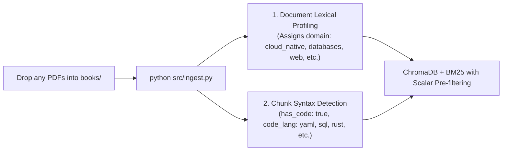
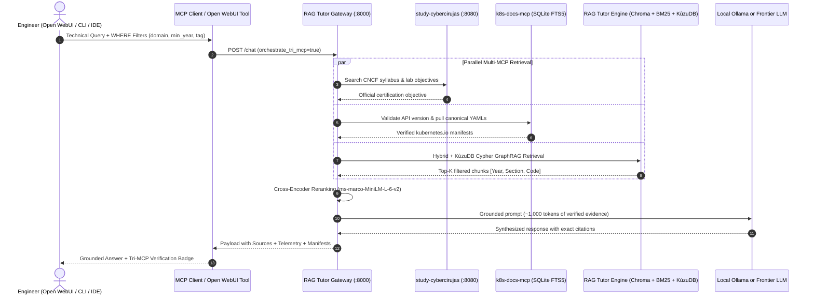

# Universal Technical RAG Tutor (rag-tutor)

Agnostic, sovereign local AI tutor for technical books (Software Engineering, Kubernetes Internals, Databases, Systems Programming in Rust/Go, Platform Engineering, AI Agents, and Cloud-Native Architectures).

> [!IMPORTANT]
> **BYOB (Bring Your Own Books) Philosophy & Universal Applicability:**
> - **You bring your own books:** This repository is a 100% open-source software engine and **does not distribute, host, or bundle copyrighted books**; the `books/` directory is intentionally empty.
> - **Works with ANY technical book:** While the initial reference benchmark was validated with 22 sources covering Cloud-Native and Platform Engineering, the engine is completely agnostic: you can drop in books on **Databases (PostgreSQL, Redis)**, **Frontend (React, TypeScript)**, **Low-level Systems (Rust, Go, C++)**, **Cybersecurity**, **Networking**, or internal engineering handbooks. The system auto-profiles and auto-classifies them on first ingestion.

It implements a **hybrid retrieval architecture (Vector + BM25 with Cross-Encoder Reranker)**, a **lightweight agentic self-reflection loop**, and **dual exposure (MCP Server + REST API)**, architecturally decoupled to iteratively scale into **Omnigraph (GraphRAG)**.

Consult the architectural decision record in [ARCHITECTURE.md](ARCHITECTURE.md), the comprehensive strategic & LLM-free usage guide in **[STRATEGIC_GUIDE_AND_USAGE.md](STRATEGIC_GUIDE_AND_USAGE.md)**, the universal metadata engine in [METADATA_SYSTEM.md](METADATA_SYSTEM.md), the open certifications multi-MCP integration in [CERTIFICATION_TUTOR_MCP.md](CERTIFICATION_TUTOR_MCP.md), the complete live demo runbook in [DEMO_RUNBOOK_EN.md](DEMO_RUNBOOK_EN.md), the command cheatsheet in [CHEATSHEET_DEMO_COMMANDS.md](CHEATSHEET_DEMO_COMMANDS.md), the real use cases and setup walkthrough in [USE_CASES_AND_EXAMPLES.md](USE_CASES_AND_EXAMPLES.md), the AI disclosure and guardrails in [AI_DISCLOSURE_AND_GUARDRAILS.md](AI_DISCLOSURE_AND_GUARDRAILS.md), and reproducible empirical tests in [VERIFICATION_TESTS.md](VERIFICATION_TESTS.md).

---

## Project Structure

```text
rag-tutor/
├── books/                     # Place your technical books/folders here (git-ignored)
│   └── .gitkeep
├── chroma_db/                 # Persistent vector database (ChromaDB, git-ignored)
├── bm25_index.pkl             # Inverted BM25 lexical index for exact code tokens (git-ignored)
├── data/kuzu_db/              # Embedded KùzuDB property graph database (git-ignored)
├── docker-compose.yml         # Optional container for Omnigraph lakehouse daemon
├── src/
│   ├── __init__.py
│   ├── config.py              # Centralized configuration and engine selector (default: omnigraph)
│   ├── core.py                # Agentic Tutor Core with self-reflection loop & retrieve_only mode
│   ├── cli.py                 # CLI with SQL-like WHERE filters (--min-year, --domain, --tag, --no-llm)
│   ├── ingest.py              # Multi-format incremental ingestion with 3-layer SHA-256 deduplication
│   ├── ingest_graph.py        # Dynamic GraphRAG & KùzuDB ontology builder (Phase 2)
│   ├── metadata_engine.py     # Universal deterministic profiler (year, domain, tags, sections, syntax)
│   ├── graph_schema.py        # Schema of nodes and edges for the knowledge graph
│   ├── kuzu_graph.py          # Embedded KùzuDB Cypher query engine for GraphRAG
│   ├── schemas.py             # Pydantic contract schemas for syllabus and external MCPs
│   ├── mcp_server.py          # Progressive Zero-Token-Burn MCP server (5 specialized tools)
│   ├── api.py                 # FastAPI REST API & Tri-MCP Gateway with WHERE filter support
│   └── retrievers/
│       ├── __init__.py
│       ├── base.py            # Abstract BaseRetriever and RetrievedChunk interfaces
│       ├── hybrid.py          # Phase 1: ChromaDB + BM25 + Cross-Encoder Reranker + WHERE filters
│       └── omnigraph.py       # Phase 2: KùzuDB Cypher + Hybrid + Cross-Encoder Reranker
├── tests/
│   └── test_no_llm_pipeline.py # Automated end-to-end test suite (Zero LLM / No Ollama required)
├── requirements.txt           # Python dependencies
├── test_multi_mcp_live.py     # Live Tri-MCP verification (study-cybercirujas + k8s-docs-mcp + rag-tutor)
├── STRATEGIC_GUIDE_AND_USAGE.md # Complete operational guide, KùzuDB breakdown & architecture patterns
├── DEMO_RUNBOOK_EN.md         # Live demo runbook: Study platform, Open WebUI, Ollama & Tri-MCP
├── DEMO_RUNBOOK_STUDY_OPENWEBUI.md # Direct alias for DEMO_RUNBOOK_EN.md
├── CHEATSHEET_DEMO_COMMANDS.md # Quick reference for CLI, cURL, MCP & hardware checks
├── GLOSSARY.md                # Educational technology glossary with real-world analogies
├── ARCHITECTURE.md            # Architecture Decision Records (ADRs) and roadmap
├── METADATA_SYSTEM.md         # Universal zero-config metadata engine documentation
├── CERTIFICATION_TUTOR_MCP.md # Open WebUI + MCP integration with study-cybercirujas
├── HOW_TO_MULTI_MCP_101.md    # Beginner 101 guide: How agents coordinate multiple MCP servers
├── USE_CASES_AND_EXAMPLES.md  # Step-by-step setup walkthrough and real terminal outputs
├── RESEARCH_AND_LESSONS_LEARNED.md # Multi-MCP orchestration research, challenges & solutions
├── AI_DISCLOSURE_AND_GUARDRAILS.md # Transparency, traceability, and guardrails (EU AI Act)
├── VERIFICATION_TESTS.md      # Empirical verification test report and reproduction steps
├── LICENSE                    # Apache 2.0 Open Source License
└── README.md
```

> [!NOTE]
> **Understanding `knowledge_graph.json` (Seed Ontology Template):**
> `knowledge_graph.json` (~7 KB) is provided as an out-of-the-box **seed ontology template** demonstrating how Phase 2 GraphRAG traverses entities and directional relationships. It contains **zero copyrighted text** (unlike vector embeddings). You are **not required to keep this specific data**: you can freely customize entities in [`src/ingest_graph.py`](src/ingest_graph.py) or regenerate it for your specific engineering domains.

---

## Iterative Roadmap

- [x] **Phase 1 (Hybrid Foundation)**:
  - Code-aware chunking optimized for YAML and Go syntax (verified with 22 sources, 8,516 pages, 23,343 chunks).
  - Hybrid retrieval (Chroma semantic dense search + BM25 exact lexical match).
  - Local reranking via Cross-Encoder (`ms-marco-MiniLM-L-6-v2`).
  - Agentic RAG reflection loop (context sufficiency evaluation in max 2 steps).
  - MCP Server compatible with `mcp 2.x` (`MCPServer`) + FastAPI REST API + interactive CLI.
- [x] **Phase 2 (GraphRAG / KùzuDB / Omnigraph)**:
  - Ontological schema definition (`src/graph_schema.py`) with domain entities and relations.
  - Embedded **KùzuDB Cypher Engine** (`src/kuzu_graph.py`) for sub-millisecond local graph traversals without Docker daemons.
  - Graph generator persisting into `knowledge_graph.json` (`src/ingest_graph.py`).
  - Dual-mode `OmnigraphRetriever` connector: remote HTTP querying to Omnigraph daemon or local in-memory/KùzuDB relationship traversal.
  - Container deployment ready with Docker Compose (`docker-compose.yml`).

---

## Universal Metadata Engine (Zero-Config)

The system features a deterministic auto-cataloging engine that supports **any technical book** (PostgreSQL, React, Rust, Cybersecurity, Kubernetes, etc.) without manual tagging:



1. **Auto-Profiling on Ingestion (Zero-Config):** When you place PDFs in `books/` and run `python src/ingest.py`, the system reads the table of contents (TOC) and initial pages, automatically assigning the domain (`cloud_native`, `databases_and_storage`, `web_and_frontend`, `systems_programming`, `devsecops`, `ai_agents`, `mlops`, `general_technical`), persisting it to `metadata_registry.json`.
2. **Chunk-Level Syntax Detection:** Pure regex analysis checks for code blocks, tagging each chunk with `has_code: true` and its exact language (`yaml | go | python | sql | rust | bash | typescript`).
3. **High-Precision Filtered Retrieval:** Enables CLI users, MCP agents, and HTTP clients to filter by domain and language, eliminating cross-domain noise and accelerating retrieval.

Read the detailed guide with practical examples in [METADATA_SYSTEM.md](METADATA_SYSTEM.md).

---

## Optional Hugging Face Authentication (HF_TOKEN)

> [!NOTE]
> **The system operates 100% locally and offline without requiring accounts or logins.**  
> Embedding and reranking models run from local cache (`~/.cache/huggingface/hub`) under `HF_HUB_OFFLINE=1`.

If you ever wish to connect your personal Hugging Face account for higher download rate limits or private models:
1. Create a free *Read* token at [huggingface.co/settings/tokens](https://huggingface.co/settings/tokens).
2. Set it in your environment:
   ```bash
   export HF_TOKEN="hf_your_token_here"
   ```
   Or via the official CLI:
   ```bash
   huggingface-cli login
   ```
If no token is set, warnings are automatically suppressed and execution runs silently offline.

---

## Prerequisites

- **Python**: 3.10 or higher (3.11 recommended).
- **Ollama**: Running locally with your chosen model (e.g., `qwen2.5:7b`):
  ```bash
  ollama pull qwen2.5:7b
  ```

---

## Installation & Setup

1. **Create and activate a virtual environment:**
   ```bash
   python -m venv .venv
   source .venv/bin/activate
   ```

2. **Install dependencies:**
   ```bash
   pip install -r requirements.txt
   ```

3. **Place your technical books or video courses (Any format / topic / vendor):**
   - Copy your `.pdf`, `.md` (or book/course folders containing `Markdown/*.md`), `.txt`, `.json`, `.jsonl`, `.vtt`, or `.srt` files into the `books/` folder. The system is 100% standalone, auto-extracts the **publication year (`publication_year`)**, **content type (`video_course` vs `book`)**, **domain**, **tags**, **hands-on exercises (`has_exercises`)**, and **chapter/section tree (`sections`)**, citing exact minute ranges (`@ [MM:SS - MM:SS]`) for video lessons.

4. **Run ingestion and indexing:**
   ```bash
   python src/ingest.py
   ```
   *(Subsequent runs only process newly added or modified books incrementally via SHA-256).*

---

## Running & Automated Testing WITHOUT an LLM (No Ollama Required)

You can use and test the entire ingestion, metadata `WHERE`-filtering, Hybrid retrieval (ChromaDB + BM25), Cross-Encoder reranking, KùzuDB GraphRAG, and MCP tools **without having Ollama or any LLM installed**:

### 1. Run the Automated Verification Suite
```bash
python tests/test_no_llm_pipeline.py
```

### 2. Query via CLI with `--no-llm` (`--retrieve-only`) and SQL-like `WHERE` Filters
```bash
# Retrieve top reranked sections with WHERE filters (no LLM needed):
python src/cli.py "How to serve LLMs with vLLM on Kubernetes?" \
  --no-llm \
  --domain cloud_native \
  --min-year 2025 \
  --tag kubernetes \
  --section "Chapter"

# Filter strictly by code language (yaml, python, go, bash, sql, rust):
python src/cli.py "Deployment resource limits GPU" \
  --no-llm \
  --code yaml \
  --min-year 2024
```

### 3. Direct MCP Tool Invocation (Zero-Token-Burn for 100+ Books)
```bash
python -c "
from src.mcp_server import listar_libros_y_secciones, buscar_fragmentos_secciones
print(listar_libros_y_secciones(domain='cloud_native', min_year=2025))
print(buscar_fragmentos_secciones('vLLM Kubernetes', top_k=2, domain='cloud_native', min_year=2025, tag='kubernetes'))
"
```

---

## Detailed Usage Modes

The tutor can be used in three complementary modes depending on your workflow:

---

### Mode 1: Local Console / CLI (`src/cli.py`)

Fast, zero-overhead terminal queries without requiring a browser or external client.

#### A. Direct query argument (single-line execution)
```bash
python src/cli.py "Explain how to design a reactive AI Agent"
```

#### B. Interactive Chat loop (continuous session)
Run without arguments for an interactive REPL:
```bash
python src/cli.py
```
```text
=================================================================
 📚 Universal Technical AI Tutor (Interactive Console)
 Type your technical query or 'exit' / 'quit' to quit.
=================================================================

> Question:
Explain the concept of Paved Roads in Platform Engineering

[... generates technical synthesis with book citations ...]

> Question:
exit
Goodbye!
```

---

### Mode 2: MCP Server - Model Context Protocol (`src/mcp_server.py`)

Exposes your book library as native function-calling tools to external AI agents in your terminal or IDE (such as **Claude Desktop**, **Goose CLI**, or **Antigravity**).

#### Start the server manually (stdio):
```bash
python src/mcp_server.py
```

#### Exposed Tools:
1. `listar_libros_y_secciones(domain, min_year, tag, incluir_secciones) -> str`:
   - Returns the compact book catalog with publication year (`publication_year`), domain, tags, and chapter/section tree without burning tokens on full book contents.
2. `buscar_fragmentos_secciones(consulta, top_k, domain, code_lang, libro, min_year, tag, seccion) -> str`:
   - Retrieves only the top-K relevant chunks with SQL-like `WHERE` pre-filters (`min_year`, `domain`, `tag`, `seccion`, `code_lang`, `libro`), requiring zero Ollama LLM overhead.
3. `consultar_grafo_kuzu(concepto: str) -> str`:
   - Queries the embedded KùzuDB Knowledge Graph via Cypher to inspect ontological relationships across books, domains, and technical concepts.
4. `consultar_libros_manning(pregunta: str, domain, code_lang, libro, min_year) -> str`:
   - Runs hybrid/graph retrieval and triggers the agentic reflection loop with Ollama to return a grounded synthesis with exact citations.
5. `buscar_codigo_yaml(termino: str, code_lang, min_year) -> str`:
   - Direct lexical retrieval for exact YAML manifests, CRDs, CLI commands, and code snippets without LLM alteration.

#### Claude Desktop / Goose CLI integration (`claude_desktop_config.json`):
```json
{
  "mcpServers": {
    "rag-tutor": {
      "command": "/path/to/rag-tutor/.venv/bin/python",
      "args": [
        "/path/to/rag-tutor/src/mcp_server.py"
      ]
    }
  }
}
```

---

### Mode 3: REST API with FastAPI (`src/api.py`)

Exposes the tutor over standard HTTP, allowing integration with Web frontends, scripts, or **Open WebUI**.

#### Start the API server:
```bash
python src/api.py
```
Default URL: [http://localhost:8000](http://localhost:8000)

#### Interactive API Documentation (Swagger UI):
Open in your browser:
👉 **[Open Swagger UI (http://localhost:8000/docs)](http://localhost:8000/docs)**
You can test the `POST /chat` endpoint directly from the UI.

#### Available Endpoints:
- `GET /health`: Healthcheck verifying ChromaDB, BM25, and local Ollama model connectivity.
- `GET /mcp/status`: Real-time monitoring and connection status across all 3 MCP servers (`study-cybercirujas`, `k8s-docs-mcp`, `rag-tutor`).
- `POST /mcp/test`: Live diagnostics endpoint with deterministic Kind extraction, stop-word filtering, and multi-manifest retrieval across all connected MCP servers.
- `POST /chat`: Query endpoint returning grounded answers, sources, and pipeline telemetry with optional Tri-MCP enrichment (`orchestrate_tri_mcp: true`).

#### Consumption examples via cURL:

```bash
# Check status of all 3 connected MCP servers:
curl -s http://localhost:8000/mcp/status | jq

# Run diagnostics with natural language query (extracts Pod, pulls 3 canonical manifests, links CKA 3.5):
curl -s -X POST http://localhost:8000/mcp/test \
  -H "Content-Type: application/json" \
  -d '{"target": "all", "query": "three example how i can create a pod yaml definition and a theory how works"}' | jq

# Ask a question with full Tri-MCP orchestration:
curl -s -X POST http://localhost:8000/chat \
  -H "Content-Type: application/json" \
  -d '{"question": "How do in-tree ValidatingAdmissionPolicies work in Kubernetes?", "orchestrate_tri_mcp": true}'
```

---

### Mode 4: Open WebUI Integration (Sovereign Web Chat)

You can connect **Open WebUI** directly to the Tri-MCP sovereign gateway using the native Python Tools system.

#### 1. Copy-Paste Tool Code for Open WebUI:
In Open WebUI, navigate to: **Workspace ➔ Tools ➔ `+` (Create Tool)**, and paste the contents of [`openwebui_tool_tri_mcp.py`](openwebui_tool_tri_mcp.py):

```python
"""
title: Cloud Native Tri-MCP Tutor
author: Cybercirujas
author_url: https://github.com/villadalmine/rag-tutor
git_url: https://github.com/villadalmine/rag-tutor
description: Queries the Sovereign Tri-MCP Stack (technical engineering books, official CNCF/LPI syllabi, and canonical Kubernetes YAMLs)
version: 1.3.0
license: Apache-2.0
"""
import json
import requests
from typing import Optional, Dict, Any

class Tools:
    def __init__(self):
        # Internal URL reachable from the Open WebUI Docker container
        self.gateway_url = "http://host.docker.internal:8000"

    def query_tri_mcp_tutor(
        self,
        question: str,
        domain: Optional[str] = None,
        min_year: Optional[int] = None,
    ) -> str:
        """
        MANDATORY TOOL: Queries the Sovereign Trifecta (study-cybercirujas + k8s-docs-mcp + rag-tutor).
        Always invoke this tool whenever the user asks about Kubernetes, Pods, Deployments,
        services, platform architecture, AI agents, CNCF syllabi (CKA, CKAD, CKS, CNPE), or YAML syntax.
        :param question: Exact technical question to resolve.
        :param domain: Optional domain filter (e.g. 'cloud_native', 'ai_agents', 'mlops').
        :param min_year: Optional minimum publication year (e.g. 2024 or 2025).
        :return: Grounded technical synthesis with verification badge and cited sources.
        """
        url = f"{self.gateway_url}/chat"
        payload = {
            "question": question,
            "orchestrate_tri_mcp": True,
            "domain": domain,
            "min_year": min_year,
        }
        try:
            resp = requests.post(url, json=payload, timeout=90.0)
            if resp.status_code == 200:
                data = resp.json()
                answer = data.get("answer", "")
                sources = data.get("sources", [])
                enrichment = data.get("mcp_enrichment", {})

                # Build Visual Tri-MCP Verification Badge
                badge_lines = [
                    "┌──────────────────────────────────────────────────────────────┐",
                    "│ 🛡️  SOVEREIGN MULTI-MCP VERIFICATION (LIVE TELEMETRY)        │",
                    "├──────────────────────────────────────────────────────────────┤",
                ]
                obj = enrichment.get("study_objective") or "General Platform Context"
                badge_lines.append(f"│ 🎯 Study-Cybercirujas: {obj[:46]:<46} │")
                kind = enrichment.get("k8s_kind") or "Core Resource"
                api_chk = enrichment.get("k8s_api_check") or "kubernetes.io canonical spec"
                badge_lines.append(f"│ 🛡️ K8s-Docs-MCP:      {kind} ({api_chk[:30]:<30}) │")
                retriever = data.get("retriever_engine", "omnigraph")
                llm = data.get("llm_model", "local-ollama")
                badge_lines.append(f"│ 📚 RAG-Tutor Engine:  {retriever} ({llm})                     │")
                badge_lines.append("└──────────────────────────────────────────────────────────────┘")
                badge_block = "```text\n" + "\n".join(badge_lines) + "\n```"

                sources_block = ""
                if sources:
                    sources_list = "\n".join([f"- `{s}`" for s in sources])
                    sources_block = f"\n\n### 📖 Consulted Sources:\n{sources_list}"

                return f"{badge_block}\n\n{answer}{sources_block}"
            return f"Error {resp.status_code} querying tutor: {resp.text}"
        except Exception as e:
            return f"Error connecting to RAG Tutor Gateway ({self.gateway_url}): {str(e)}"

    def check_mcp_cluster_status(self) -> str:
        """Checks the live connection status of all 3 MCP servers."""
        url = f"{self.gateway_url}/mcp/status"
        try:
            resp = requests.get(url, timeout=10.0)
            if resp.status_code == 200:
                data = resp.json()
                servers = data.get("servers", {})
                status_summary = [f"### Tri-MCP Cluster Status (Operational: {data.get('tri_mcp_operational')})\n"]
                for name, s in servers.items():
                    mode_info = f" (Mode: {s.get('mode')})" if "mode" in s else ""
                    tools_list = ", ".join(s.get("tools", []))
                    status_summary.append(f"- **{name}**: `{s.get('status')}`{mode_info} | Tools: [{tools_list}]")
                return "\n".join(status_summary)
            return f"Error {resp.status_code}: {resp.text}"
        except Exception as e:
            return f"Connection error: {str(e)}"
```

#### 2. Assign the Tool to Your Model in Open WebUI:
1. Navigate to **Workspace ➔ Models ➔ `+` (Create Model)**.
2. Configure:
   - **Name:** `Cloud Native Tutor (Tri-MCP)`
   - **Base Model:** Select `qwen3:4b-fast` or `qwen2.5:7b`.
   - **System Prompt:**
     ```text
     You are a Principal Platform Architect and Senior Cloud-Native Instructor.
     You have access to the 'Cloud Native Tri-MCP Tutor' tool.
     Whenever the user asks about Kubernetes, certifications (CKA, CKAD, CKS, CNPE),
     AI agents, platform architecture, or YAML manifests, invoke 'query_tri_mcp_tutor'
     to ground your answer in official sources and prevent API hallucinations.
     ```
   - **Tools:** Check the **`Cloud Native Tri-MCP Tutor`** box.
3. Save the model.

> [!IMPORTANT]
> **Ensure the tool is toggled ON in the chat:**  
> In the bottom chat input bar of Open WebUI, click the **Tools (Puzzle 🧩)** icon and confirm **`Cloud Native Tri-MCP Tutor` is enabled**. If it is unchecked, the model will respond without invoking the tool.
> You can audit live queries received by the Gateway in your browser at:
> 👉 **[http://localhost:8000/mcp/logs](http://localhost:8000/mcp/logs)**

---

### Execution Sequence Diagram:



> [!TIP]
> For the complete list of CLI commands, `curl` calls, hardware validations (GPU vs CPU), Open WebUI setup steps, and cold-start instructions, consult:
> 👉 **[CHEATSHEET_DEMO_COMMANDS.md](CHEATSHEET_DEMO_COMMANDS.md)** and **[STRATEGIC_GUIDE_AND_USAGE.md](STRATEGIC_GUIDE_AND_USAGE.md)**

---

## Technologies & Upstream Repositories

| Technology | Official Repository | Role in the Project |
| :--- | :--- | :--- |
| **KùzuDB** | [kuzudb/kuzu](https://github.com/kuzudb/kuzu) | Embedded C++ property graph database executing declarative Cypher queries for Phase 2 GraphRAG. |
| **ModernRelay Omnigraph** | [ModernRelay/omnigraph](https://github.com/ModernRelay/omnigraph) | Lakehouse-native graph database over Lance with Git-style branching for agentic state (Phase 2). |
| **Lance** | [lancedb/lance](https://github.com/lancedb/lance) | Modern columnar format for multimodal data and high-performance vector search. |
| **ChromaDB** | [chroma-core/chroma](https://github.com/chroma-core/chroma) | Embedded open-source vector database for dense indexing and scalar metadata pre-filtering. |
| **Rank-BM25** | [dorianbrown/rank_bm25](https://github.com/dorianbrown/rank_bm25) | Okapi BM25 lexical search implementation for exact code tokens, CRDs, and keywords. |
| **Sentence-Transformers** | [UKPLab/sentence-transformers](https://github.com/UKPLab/sentence-transformers) | Dense embedding models (`all-MiniLM-L6-v2`) and Cross-Encoder rerankers (`ms-marco-MiniLM-L-6-v2`). |
| **LangChain Core & Community** | [langchain-ai/langchain](https://github.com/langchain-ai/langchain) | RAG orchestration abstractions, code-aware text splitters, and document loaders. |
| **PyMuPDF (fitz)** | [pymupdf/PyMuPDF](https://github.com/pymupdf/PyMuPDF) | High-speed C-based text, metadata, and page extraction from PDF documents. |
| **Model Context Protocol (MCP)** | [modelcontextprotocol/python-sdk](https://github.com/modelcontextprotocol/python-sdk) | Official SDK exposing progressive Zero-Token-Burn tools to agents via MCP (`MCPServer` / `FastMCP`). |
| **FastAPI** | [fastapi/fastapi](https://github.com/fastapi/fastapi) | Async web framework powering the REST API and interactive Swagger documentation. |
| **Ollama** | [ollama/ollama](https://github.com/ollama/ollama) | Optional local model inference engine running on consumer hardware (CPU / GPU / Apple Silicon). |
| **Qwen 2.5 (Alibaba)** | [QwenLM/Qwen2.5](https://github.com/QwenLM/Qwen2.5) | Open-weights foundation models used for local agentic reasoning and technical synthesis. |
| **uv (Astral)** | [astral-sh/uv](https://github.com/astral-sh/uv) | High-speed Rust-based Python package manager and resolver. |

---

## 📖 Educational Technology Glossary (For Technical & Non-Technical Readers)

For a clear, accessible explanation of every technology used in this ecosystem (RAG, MCP, ChromaDB, BM25, KùzuDB, Cross-Encoder, Ollama, Qwen, ROCm, etc.) with **everyday real-world analogies** and architectural rationale, consult:
👉 **[GLOSSARY.md](GLOSSARY.md)**

---

## AI Disclosure, Transparency & Guardrails

All educational explanations generated by `rag-tutor` are produced by locally executed large language models. In alignment with open educational initiatives like [study-cybercirujas](https://github.com/villadalmine/study-cybercirujas):
- The system functions strictly as a **study aid**; original engineering books and vendor documentation are the ultimate authority.
- The pipeline implements **4 automated mechanical guardrails**: Cross-Encoder Reranking, Agentic Self-Reflection Loop, Mandatory Page Citations, and Sovereign Local Data Privacy.
- Complies with transparency and traceability standards aligned with **EU AI Act Article 50**.

Read the full disclosure and policy in [AI_DISCLOSURE_AND_GUARDRAILS.md](AI_DISCLOSURE_AND_GUARDRAILS.md).

---

## Empirical Verification Tests & Reproducibility

All claims regarding sub-350ms pre-LLM latency, dilution mitigation across 23,343 chunks, and exact page citation fidelity have been empirically validated on local hardware.

Read the execution logs, model telemetry, and reproduction instructions in [VERIFICATION_TESTS.md](VERIFICATION_TESTS.md).

---

## Multi-MCP Research, Architecture & Lessons Learned

For an in-depth analysis of how autonomous agents can coordinate multiple MCP servers (`study-cybercirujas`, `k8s-docs-mcp`, and `rag-tutor`) without tool collisions, context bloat, or hallucinations, consult **[RESEARCH_AND_LESSONS_LEARNED.md](RESEARCH_AND_LESSONS_LEARNED.md)**. It covers:
1. **The Core Multi-MCP Problem:** Why free-wheeling ReAct loops hallucinate and fail in production.
2. **The Separation of Powers Contract:** Semantic boundary allocation between Syllabus, Specification, and Architecture.
3. **Key Implementations:** SHA-256 incremental hashing, embedded KùzuDB Cypher engine, Hugo shortcode preprocessors, and SQLite FTS5 stores.
4. **Behind-the-Scenes Hurdles:** Resolving batch insert limits, UTF-8 Windows stream encoding, and deterministic OpenAPI schema validation.
5. **Research Scope Notice:** Clear framing of this project as an educational proof-of-concept for sovereign information access.

For an intuitive, step-by-step 101 guide explaining how an AI agent decides which MCP to consult (e.g. answering *"How does etcd work in K8s?"* without querying all tools blindly), read **[HOW_TO_MULTI_MCP_101.md](HOW_TO_MULTI_MCP_101.md)**.

---

## Real Use Cases & Terminal Outputs

To see how the engine operates in practice on real hardware, consult **[USE_CASES_AND_EXAMPLES.md](USE_CASES_AND_EXAMPLES.md)**. It documents:
1. **"How I Made It Work" Walkthrough:** From clean virtualenv initialization to handling ChromaDB's 5,461-chunk batch limits with 2,000-chunk slicing during ingestion.
2. **Real Terminal Output 1:** Deep K8s Internals (Mutating vs Validating Admission Controllers).
3. **Real Terminal Output 2:** Agentic Self-Reflection (Golden Paths & Developer Cognitive Load with automatic literature query reformulation).
4. **Real Terminal Output 3:** Systems & AI Trade-offs (Fine-Tuning vs RAG).
5. **Real Terminal Output 4:** Pure Lexical Retrieval (`buscar_codigo_yaml` for exact manifest extraction).
6. **Real Terminal Output 5:** Tri-MCP Certification Study Session paired with [study-cybercirujas](https://github.com/villadalmine/study-cybercirujas) and [k8s-docs-mcp](https://github.com/villadalmine/k8s-docs-mcp).

---

## Copyright, Fair Use & Citation Notice

This repository is an open-source technical benchmark and local study tool (licensed under Apache 2.0).

- **Zero Content Redistribution (BYOB - Bring Your Own Books):** This repository **does NOT host, mirror, or redistribute** any copyrighted book files, PDFs, full chapters, or commercial training datasets. Users must supply their own legally acquired reference documents in their local `data/` or `books/` directory.
- **Index Privacy & Data Sovereignty:** Vector databases (`chroma_db/`), lexical indexes (`bm25_index.pkl`), and private model caches are strictly excluded via `.gitignore` to prevent distributing derivative mathematical representations of private texts.
- **Nominative Fair Use of Book Titles & Citations:** All book titles (*Effective Platform Engineering*, *Core Kubernetes*, *GitOps and Kubernetes*), publisher names (e.g. Manning Publications), and author attributions appearing in benchmark logs or citation metadata are the property of their respective copyright holders. Under international copyright law and US Fair Use principles (Circular 33, US Copyright Office), titles and short factual identifiers are not copyrightable; they are referenced strictly for **bibliographic citation, scholarly attribution, and academic reproducibility**.
- **Educational Scope:** The system functions purely as an educational retrieval agent. The authoritative technical sources remain the original books and official documentation.

---

## License

This project is licensed under the **Apache License 2.0**. See [LICENSE](LICENSE) for details.


