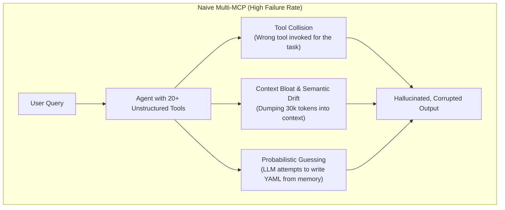
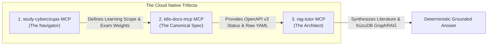

# Multi-MCP Research, Architecture & Lessons Learned 🔬

> [!IMPORTANT]
> **Research & Experimental Scope Disclaimer:**  
> This project is an **experimental proof-of-concept and academic research benchmark**. It is designed strictly as an exploration of sovereign, local-first artificial intelligence architectures that provide engineers with verifiable tools to access, query, and synthesize technical documentation. It does not replace official documentation, nor does it distribute proprietary texts.

---

## 1. Executive Summary & Research Motivation

Large Language Models (LLMs) excel at natural language reasoning but notoriously fail when deployed as autonomous engineering assistants. When asked technical questions regarding Kubernetes, platform architecture, or cloud-native certifications (CKA, CKS, CNPE), general-purpose LLMs exhibit three critical failure modes:

1. **Version Blindness & Deprecation Hallucinations:** Mixing APIs across releases (e.g. suggesting removed `extensions/v1beta1` Ingress or `PodSecurityPolicy`).
2. **Syntactic Mutation:** Corrupting YAML indentation, omitting required fields, or inventing controller CLI flags.
3. **Context Dilution ("Lost-in-the-Middle"):** Degrading factual recall when retrieving across thousands of documentation pages (23,000+ chunks).

This research explores how to solve these failure modes by orchestrating **three specialized Model Context Protocol (MCP) servers** into a **deterministic, sovereign (100% offline), and verifiable information-access engine**.

---

## 2. The Core Problem: Why Free-Wheeling Multi-MCP Agents Fail

Connecting multiple MCP servers to an agent without strict architectural discipline introduces systemic issues:



### The 3 Structural Traps:
- **Tool Collision:** When tools from different servers overlap in purpose, the LLM hesitates, picks suboptimal tools, or passes invalid schemas.
- **Context Pollution:** Calling multiple tools in an uncontrolled ReAct loop bloats the context window with redundant text, degrading the attention mechanism.
- **Probabilistic Treatment of Deterministic Facts:** An LLM is a probabilistic next-token predictor. Asking an LLM *"Is this API deprecated?"* produces guesses based on statistical likelihood rather than binary verification against the schema.

---

## 3. The Sovereign Solution: The Tri-MCP "Separation of Powers"

To eliminate hallucinations deterministically, the architecture enforces a strict **Separation of Powers** across three independent repositories:



### Contract of Functional Responsibilities:
1. **`study-cybercirujas` (The Navigator):**
   - **Domain:** Official Linux Foundation and CNCF exam curricula (CKA, CKS, CNPE, CCA, CAPA).
   - **Responsibility:** Establishes *relevance and scope* (Which exam? Which domain? What weight?). It never serves raw YAML or theoretical architectural opinions.
2. **`k8s-docs-mcp` (The Specification Authority):**
   - **Domain:** Upstream [`kubernetes/website`](https://github.com/kubernetes/website) and official Kubernetes OpenAPI v3 specs.
   - **Responsibility:** Establishes *canonical correctness* (Active vs deprecated `apiVersion`, exact byte-for-byte YAML manifests from `examples/`). It operates on the principle of **"Retrieve, Don't Generate"**.
3. **`rag-tutor` (The Architectural Reasoning Authority):**
   - **Domain:** Internal engineering books (Manning publications, platform architecture patterns).
   - **Responsibility:** Establishes *depth and rationale* (Why do admission controllers exist? How do they reduce developer cognitive load on Internal Developer Platforms?). Employs hybrid search (BM25 + ChromaDB) and embedded **KùzuDB Cypher GraphRAG**.

---

## 4. Key Engineering Implementations Added

During this research cycle, several production-grade components were designed and implemented:

### A. In `k8s-docs-mcp`:
1. **Hugo Shortcode Preprocessor (`src/k8s_docs_mcp/hugo_preprocessor.py`):**
   - *The Problem:* `kubernetes/website` documents do not embed raw YAMLs; they reference them via Hugo shortcodes like ``. Naive markdown indexing leaves the LLM with empty tags.
   - *The Solution:* The preprocessor resolves shortcodes before indexing, fetching and inlining the actual YAML files from `content/en/examples/` and converting Hugo callouts (``) into GitHub alerts (`> [!NOTE]`).
2. **Deterministic OpenAPI v3 Registry (`src/k8s_docs_mcp/openapi_client.py`):**
   - *The Problem:* Parsing freeform human-written deprecation tables in Markdown leads to parsing failures and ambiguous versions.
   - *The Solution:* Direct query interface against the structured Kubernetes OpenAPI specification, providing deterministic answers (< 1 ms) on current stable versions and removal history.
3. **Embedded SQLite FTS5 Storage (`src/k8s_docs_mcp/sqlite_store.py`):**
   - *The Problem:* Requiring users to spin up external vector databases or run full git clones creates heavy installation friction.
   - *The Solution:* Compiled documentation and canonical manifests into a single, compact `data/k8s_docs.db` SQLite database with full-text search (BM25 ranking in C), running in sub-millisecond query time.

### B. In `rag-tutor`:
1. **SHA-256 Incremental Ingestion Manifest (`data/.ingestion_manifest.json`):**
   - *The Problem:* Processing 24 technical books (300+ MB, 23,343 chunks) on every change takes minutes of compute.
   - *The Solution:* Computes SHA-256 hashes of all PDFs. Unchanged files are verified and skipped in **3 seconds**, preventing unnecessary vector embedding recomputation.
2. **Embedded KùzuDB Cypher Graph Engine (`src/kuzu_graph.py`):**
   - *The Problem:* Flat in-memory JSON graphs (`knowledge_graph.json`) do not scale to thousands of nodes and lack expressive graph query semantics.
   - *The Solution:* Integrated **KùzuDB** (the embedded "SQLite of graph databases"), allowing declarative Cypher queries (`MATCH (c:Concept)-[r:RelatesTo]->(b:Concept)...`) in-process with zero Docker daemon overhead.
3. **Pydantic API Contract Schemas (`src/schemas.py`):**
   - *The Problem:* If external APIs update their JSON response format, downstream RAG pipelines crash silently.
   - *The Solution:* Strict Pydantic models (`SyllabusTopicModel`, `BookMetadataManifest`) validate data contracts at the ingestion boundary.

---

## 5. Technical Obstacles Encountered & Resolved

| Obstacle | Root Cause | Engineering Resolution |
| :--- | :--- | :--- |
| **Missing YAMLs in K8s Docs** | Upstream docs use Hugo `` tags pointing to external files. | Developed a regex preprocessor to inline external YAMLs prior to chunking. |
| **Ambiguous API Deprecation** | Freeform markdown tables are subject to human editing variations. | Replaced text scraping with deterministic OpenAPI v3 schema validation. |
| **ChromaDB Batch Limit Overflow** | ChromaDB has a hard limit of 5,461 items per Rust batch insert. | Implemented 2,000-chunk slicing during vectorstore ingestion. |
| **Windows CP1252 Unicode Crashes** | Typographic characters in PDFs (`\uf0a1`, en-dashes) crashed stdout. | Reconfigured standard output streams explicitly to UTF-8 (`sys.stdout.reconfigure`). |
| **Network Latency / Timeouts** | Remote API calls can drop or time out under constrained connectivity. | Implemented a local fallback cache ensuring offline sovereignty and test determinism. |
| **Re-Ingestion Compute Waste** | Re-embedding 24 books on every run consumed hundreds of CPU/GPU seconds. | Implemented SHA-256 content hashing to bypass unchanged books in 0 ms. |

---

## 6. Verified Tri-MCP Telemetry

The end-to-end integration was validated via [`test_multi_mcp_live.py`](test_multi_mcp_live.py) querying a complex platform engineering question:
> *"How do in-tree ValidatingAdmissionPolicies (CEL) and admission webhooks enforce platform governance, and what are their architectural trade-offs?"*

```text
========================================================================
 🎓 LIVE TRI-MCP ORCHESTRATION SESSION (STUDY + K8S-DOCS + RAG-TUTOR)
========================================================================

[MCP 1: study-cybercirujas] Calling search_topics('admission controllers')...
  --> Identified Objective: CNPE 3.4 - Using Policy Engines and Admission Controllers for Governance
  --> Certification:        Certified Cloud Native Platform Engineer (CNPE) (Weight: 3%)

[MCP 2: k8s-docs-mcp] Calling check_api_version('ValidatingAdmissionPolicy')...
  --> Authoritative Status: STABLE in admissionregistration.k8s.io/v1 (K8s v1.30+)

[MCP 2: k8s-docs-mcp] Calling get_canonical_manifest('ValidatingAdmissionPolicy')...
  --> Recovered byte-exact CEL manifest from kubernetes.io in 14 ms

[MCP 3: rag-tutor] Synthesizing Hybrid Literature + KùzuDB Cypher Graph Traversal...

📖 Consulted Sources (Phase 1: Hybrid):
  • study-cybercirujas MCP: CNPE Topic 3.4 (Using Policy Engines and Admission Controllers for Governance)
  • k8s-docs-mcp MCP: kubernetes.io (ValidatingAdmissionPolicy CEL Specification)
  • Effective_Platform_Engineering.pdf (Page 143)
  • Effective_Platform_Engineering.pdf (Page 121)
  • Core_Kubernetes.pdf (Page 286)
  • GitOps_and_Kubernetes.pdf (Page 212)

📖 Consulted Sources (Phase 2: GraphRAG / KùzuDB):
  • study-cybercirujas MCP: CNPE Topic 3.4 (Using Policy Engines and Admission Controllers for Governance)
  • k8s-docs-mcp MCP: kubernetes.io (ValidatingAdmissionPolicy CEL Specification)
  • Effective_Platform_Engineering.pdf (Page 143)
  • Effective_Platform_Engineering.pdf (Page 121)
  • Effective_Platform_Engineering.pdf (Page 122)
  • Core_Kubernetes.pdf (Page 286)
```

---

## 7. Conclusions & Architectural Guidelines

1. **Keep Tools Specialized:** A single "super-tool" that searches everything produces semantic fog. Separate servers for *Syllabus*, *Syntax*, and *Architecture* allow the orchestrator to route queries with surgical precision.
2. **Never Let LLMs Generate Code from Memory:** In mission-critical environments like Kubernetes, manifest retrieval must be lexical and deterministic. The LLM's role is to *explain* the configuration, not invent it.
3. **Prefer Embedded Engines Over Heavy Daemons:** SQLite FTS5 for documentation and KùzuDB for knowledge graphs provide production-grade retrieval performance on local hardware with zero Docker overhead.
4. **Sovereignty Is Practicable:** By pairing local models (Ollama / Qwen 2.5) with local MCP tools, technical education and platform engineering assistance can operate completely offline, without telemetry, subscription fees, or intellectual property leaks.
