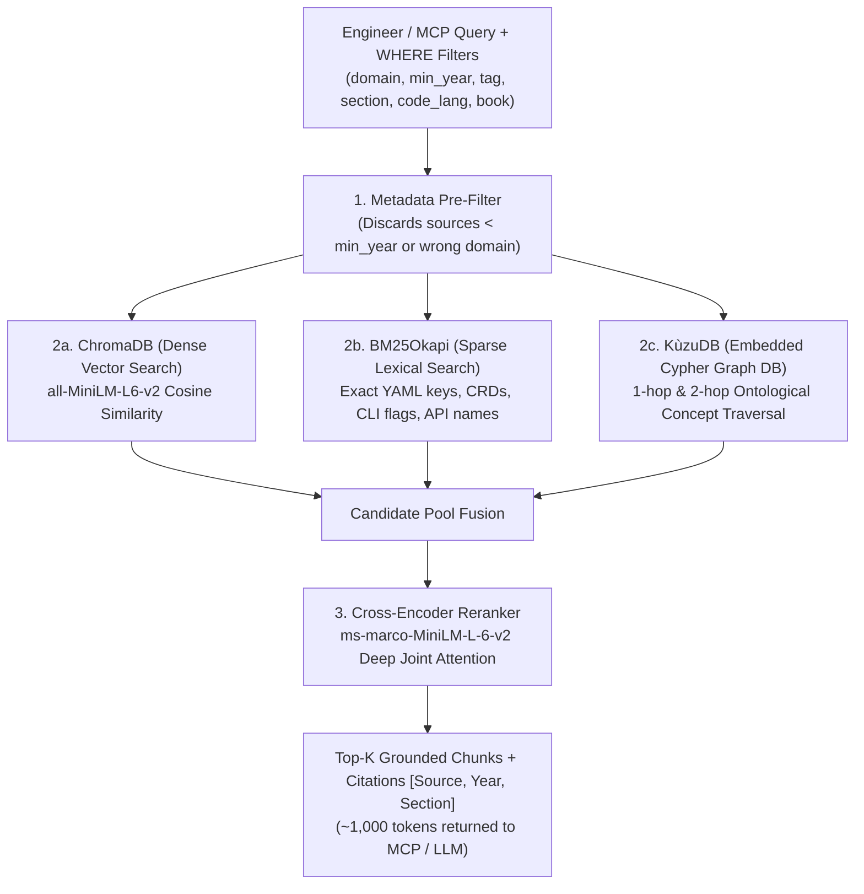
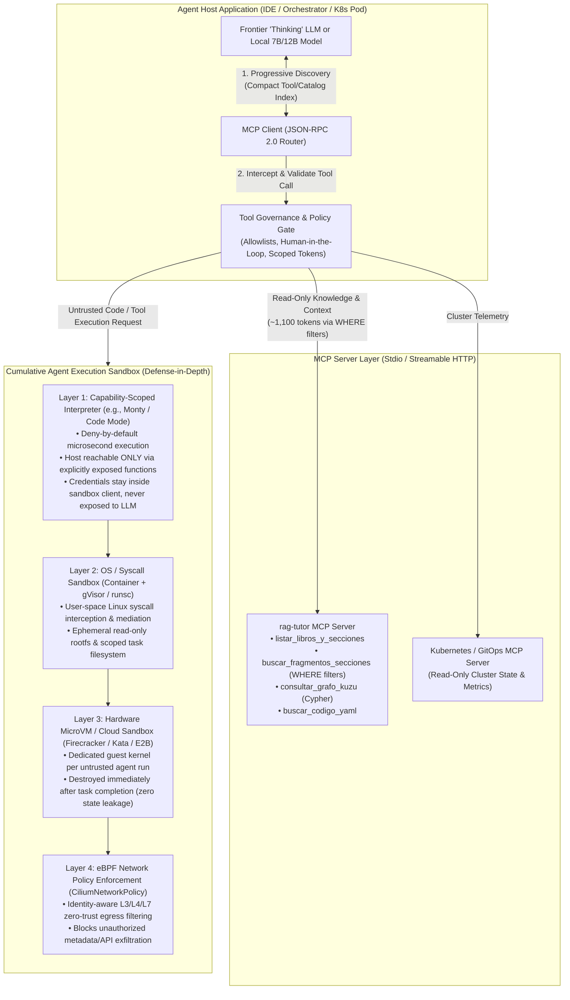

# Strategic Architecture, Usage & Value Guide (`rag-tutor`)

This document explains **step-by-step how to operate the system**, **how to sync new document folders in one command without duplicating existing ones**, **how each retrieval engine works under the hood (ChromaDB, BM25, Cross-Encoder, KùzuDB)**, **empirical token-saving benchmarks**, **Local 7B/12B vs. Paid Cloud "Thinking" LLMs**, and a **real-world MCP Architectural Case Study on Agent Sandboxing & Tool Execution**.

---

## 1. Automated Multi-Domain Profiling & Taxonomy Overview

When technical documentation, internal engineering runbooks, reference books, or video course transcripts (`.pdf`, `.md`, `.txt`, `.json`, `.jsonl`, `.vtt`, `.srt`, or multi-chapter Markdown folders) are placed in `books/`, the **Universal Deterministic Metadata Engine** (`src/metadata_engine.py`) profiles each source in `< 50 ms` without requiring an LLM:

| Sample Technical Corpus Profile (`source`) | Year | Primary Domain | Secondary Domains | Key Auto-Extracted Tags |
| :--- | :---: | :--- | :--- | :--- |
| `agentic-systems-handbook` | **2026** | `ai_agents` | `mlops` | `agent`, `llm`, `reasoning`, `agentic`, `langgraph`, `react` |
| `mcp-protocol-architecture` | **2026** | `ai_agents` | — | `mcp`, `agent`, `tool_calling`, `model_context_protocol` |
| `agentic-graphrag-patterns` | **2026** | `ai_agents` | `mlops` | `agentic`, `graphrag`, `knowledge_graph`, `rag`, `llm` |
| `cloud-native-ai-on-kubernetes` | **2026** | `cloud_native` | `mlops` | `kubernetes`, `llm`, `gpu`, `pod`, `vllm`, `ray`, `helm` |
| `llm-serving-and-optimization` | **2026** | `mlops` | `cloud_native` | `llm`, `model_serving`, `inference`, `gpu`, `vllm`, `transformer` |
| `ebpf-and-cilium-networking` | **2026** | `cloud_native` | `devsecops_and_security` | `cilium`, `ebpf`, `kubernetes`, `hubble`, `cni`, `zero_trust` |
| `k8s-legacy-operations-manual` | **2019** | `cloud_native` | — | `kubernetes`, `container`, `docker`, `deployment` |

> [!IMPORTANT]
> **Privacy & OPSEC by Design:**
> All local index state (`metadata_registry.json`, `data/.ingestion_manifest.json`, `knowledge_graph.json`, `chroma_db/`, `bm25_index.pkl`, and `data/kuzu_db/`) is strictly **git-ignored** via `.gitignore`. Your private technical library inventory, filenames, and SHA-256 hashes are never committed or exposed in version control.

---

## 2. Step-by-Step Usage Commands

### A. Syncing & Indexing Technical Folders (One-Command Incremental Workflow)
To ingest documents placed in `books/`—or to sync `Markdown/` chapter subdirectories from an external export folder while automatically skipping binary archives—run:
```bash
# Standard incremental ingestion of books/
.venv/bin/python src/ingest.py

# Or sync Markdown subdirectories from an external directory and index only new/modified sources:
.venv/bin/python src/ingest.py --sync-dir /path/to/external/markdown-library
```
What incremental ingestion does automatically:
1. **3-Layer Deduplication:**
   - **Layer 1 (Exact Source + SHA-256):** Skips any source in `books/` whose SHA-256 hash matches `data/.ingestion_manifest.json`.
   - **Layer 2 (Content SHA-256 Match Across Filenames):** Skips identical content renamed to another folder or file.
   - **Layer 3 (Normalized Title Match Across Formats):** Skips `cloud-native-k8s.pdf` if `cloud-native-k8s` is already indexed as a Markdown folder.
2. Extracts metadata (`publication_year`, `content_type` [video_course vs book], `domain`, `secondary_domains`, `tags`, `has_exercises`, `sections`, `code_lang`, video lesson timestamps `[MM:SS - MM:SS]`), embeds **only the new sources**, updates `bm25_index.pkl`, and synchronizes the KùzuDB graph (`data/kuzu_db`).

### B. Inspecting the Local Catalog & Section Trees (Zero LLM Required)
```bash
# List all locally indexed sources with publication year, domain, tags, and chapter tree
.venv/bin/python src/cli.py --list-books

# Filter catalog by domain and publication freshness (excludes pre-2024 manuals automatically)
.venv/bin/python src/cli.py --list-books --domain cloud_native --min-year 2024
```

### C. Querying from the CLI (With or Without a Local LLM)
```bash
# 1. Deterministic Retrieve-Only Mode (No Ollama / No LLM required, ~2 seconds on CPU)
.venv/bin/python src/cli.py "How does Cilium enforce eBPF network policies in Kubernetes?" \
  --domain cloud_native --min-year 2025 --tag cilium --no-llm

# 2. Full Agentic Synthesis Mode (Requires local Ollama running)
.venv/bin/python src/cli.py "Compare vLLM and Ray Serve on Kubernetes GPU nodes" \
  --domain cloud_native --min-year 2025
```

### D. Overriding Source Metadata Manually (Protected Across Re-Index Runs)
```bash
.venv/bin/python src/cli.py \
  --set-book "ebpf-and-cilium-networking" \
  --set-domain "cloud_native" \
  --set-tags "cilium,ebpf,kubernetes,hubble,cni,zero_trust" \
  --set-year 2026
```

---

## 3. How the 4 Retrieval Engines Work Together & Where KùzuDB Is Used



### Exact Role of Each Component:
1. **ChromaDB (`chroma_db/` — Dense Vector Database):**
   - Stores 384-dimensional embeddings (`sentence-transformers/all-MiniLM-L6-v2`) alongside scalar metadata (`publication_year`, `domain`, `tags`, `chapter`, `section_title`, `code_lang`).
   - Captures **conceptual and semantic similarity** even when wording differs.
2. **BM25 (`bm25_index.pkl` — Sparse Lexical Index):**
   - Uses `BM25Okapi` term-frequency / inverse-document-frequency scoring.
   - Captures **exact technical tokens** where vector embeddings struggle: `CiliumNetworkPolicy`, `vllm-server`, `nvidia.com/gpu`, `StatefulSet`, `RayCluster`.
3. **Cross-Encoder Reranker (`cross-encoder/ms-marco-MiniLM-L-6-v2`):**
   - Evaluates `[query, candidate_chunk]` pairs jointly through a transformer cross-attention head and outputs a calibrated logit score (e.g., `+8.25` for highly relevant vs. `-4.10` for tangential noise).
4. **KùzuDB (`data/kuzu_db` — Embedded C++ Property Graph Database with Cypher):**
   - **Where KùzuDB is used in the codebase:**
     1. **`src/kuzu_graph.py` (`KuzuGraphEngine`):** Initializes the embedded disk-backed property graph at `data/kuzu_db` with two Cypher tables (`Concept` node table and `RelatesTo` edge table) and executes declarative Cypher queries (`MATCH (a:Concept)-[r:RelatesTo]->(b:Concept) WHERE a.id = $id OR b.id = $id RETURN ...`).
     2. **`src/ingest_graph.py` (`sync_graph_and_kuzu`):** Automatically invoked at Step 5 of `src/ingest.py`. Links all indexed sources, domains, extracted tags, and seed architectural concepts into directed edges (`BELONGS_TO_DOMAIN`, `COVERS_CONCEPT`, `EXPLAINS`, `IMPLEMENTS`, `USES`, `RETRIEVES_FROM`) and syncs them into `data/kuzu_db`.
     3. **`src/retrievers/omnigraph.py` (`OmnigraphRetriever._traverse_local_graph`):** Enabled by default (`RETRIEVER_TYPE="omnigraph"` in `src/config.py`). On every query, it detects entities mentioned in the prompt, queries `KuzuGraphEngine.get_related_concepts()` via Cypher, boosts candidate chunks (+0.25 per connected graph concept), and prepends `[Related Architecture Topology in Knowledge Graph]` to the top chunk.
     4. **`src/mcp_server.py` (`consultar_grafo_kuzu`):** Exposes KùzuDB directly as an MCP tool so any connected agent can inspect how concepts and sources relate across your library.

---

## 4. Real-World MCP Case Study: Agent Sandboxing & MCP Tool Consumption

Below is an architectural synthesis demonstrating how a Frontier LLM connected to this repository's local MCP tools (`listar_libros_y_secciones`, `buscar_fragmentos_secciones`, and `consultar_grafo_kuzu` with `min_year=2025`) retrieves grounded patterns to design a defense-in-depth agent sandbox:

### A. How an AI Agent Consumes MCP Servers & Tools inside a Multi-Layer Sandbox



### B. Best Practices Synthesized via MCP (`min_year=2025`)

1. **Cumulative 3-Tier Runtime Isolation:**
   - **Standard Docker containers are not a hard security boundary** for untrusted agent-generated code because they share the host Linux kernel.
   - Production agent platforms stack **three cumulative boundaries**:
     1. **Capability-Scoped Interpreter (e.g., Monty):** Used for programmatic tool composition. Provides deny-by-default execution with microsecond startup where the host is reachable *only* through explicitly exposed functions.
     2. **User-Space Syscall Interception (`gVisor` / `runsc`):** Intercepts and mediates Linux syscalls in user space while maintaining standard Kubernetes container compatibility.
     3. **Hardware-Virtualized MicroVMs (`Firecracker` / Cloud Sandboxes like E2B, Daytona, Runloop):** Purpose-built lightweight microVMs providing hardware-level isolation with millisecond startup for high-risk, untrusted code execution.
2. **Ephemeral Lifecycle & Zero State Leakage:**
   - Execution environments must be **created on demand, scoped to a single task/session/agent run, and destroyed immediately afterward**.
   - The agent never executes arbitrary code inside its own control-plane runtime; it submits structured execution requests to the ephemeral sandbox and receives structured stdout/stderr results.
3. **MCP "Code Mode" & Credential Isolation:**
   - Instead of dumping massive raw MCP tool schemas into the LLM context window (which burns tokens and degrades tool-selection accuracy), **Code Mode** compiles MCP tool specs into a compact typed API.
   - The LLM writes compact code executed inside the **isolated sandbox**, which acts as a secondary MCP client issuing JSON-RPC `CallTool` messages. **Credentials remain strictly inside the sandbox boundary and are never exposed to the LLM context.**
4. **Kubernetes eBPF Zero-Trust Egress Filtering (`CiliumNetworkPolicy`):**
   - On Kubernetes AI platforms, pair runtime sandboxes (`RuntimeClass: gvisor` or `kata-fc`) with **Cilium eBPF identity-aware policies (`CiliumNetworkPolicy`)** to enforce default-deny egress so a sandboxed agent pod cannot reach the Kubernetes API server, cloud instance metadata (`169.254.169.254`), or unauthorized external endpoints.

---

## 5. Deep Architectural Comparison: Small Local Model (7B/12B on CPU/GPU) vs. Paid Subscription "Thinking" LLM + This MCP

| Architectural Dimension | Scenario A: Local 7B/12B Model (`qwen2.5-coder:7b` / `llama3.2`) + `rag-tutor` | Scenario B: Paid Subscription "Thinking" LLM (Claude 3.7/4 Sonnet/Opus, o3, GPT-5) + `rag-tutor` MCP |
| :--- | :--- | :--- |
| **Where Retrieval Happens** | **100% Local on your machine** (`ChromaDB` + `BM25` + `Cross-Encoder` + `KùzuDB`). | **100% Local on your machine** via MCP (`buscar_fragmentos_secciones` / `consultar_grafo_kuzu`). |
| **Token Cost on Paid APIs** | **$0.00 (Zero cloud tokens)**. Everything runs offline on your hardware. | **Minimal (~900–1,400 input tokens per query)** instead of 150,000+ tokens (**99% token reduction**). |
| **Primary Strength** | **Fact Extraction, Boilerplate & Command Lookup:** Summarizing retrieved chapters, extracting exact YAML manifests, CLI flags, or Dockerfile templates already written in your references. | **Multi-Constraint System Design, Trade-Off Analysis & Critical Architecture Review:** Synthesizing constraints across multiple domains + your live cluster topology. |
| **Reasoning Depth ("Thinking")** | **Shallow / Linear (1–2 hops):** 7B/12B models have limited working memory and weak test-time compute. If asked *"Critique my multi-tenant K8s GPU architecture and design an eBPF + Firecracker sandbox for MCP agents"*, a 7B model will mostly paraphrase the retrieved paragraphs without spotting subtle failure modes. | **Deep Multi-Step Test-Time Compute (Chain-of-Thought):** A Thinking LLM uses internal reasoning tokens to cross-examine the exact 2025–2026 fragments returned by your MCP against your specific constraints (e.g., PCIe vs. NVLink bottlenecks, Cilium L7 DNS policies, gVisor GPU pass-through limitations) and produces a bespoke, production-grade design. |
| **Risk of Hallucination / Outdated APIs** | Low on direct lookups (grounded by `min_year=2025`), but higher when asked to extrapolate beyond the literal text. | **Near-Zero** because your MCP injects verified 2025–2026 reference fragments (preventing the cloud LLM from falling back on outdated training weights), while the cloud LLM contributes frontier reasoning. |
| **Ideal Use Cases for an AI Platform / K8s Engineer** | • Air-gapped / offline debugging on planes or restricted environments.<br>• Automated CI/CD retrieval tests (`--no-llm`).<br>• Quick syntax/command lookups without touching paid quotas. | • Designing a new Internal Developer Platform (IDP) or multi-tenant vLLM/Ray inference cluster.<br>• Evaluating architectural trade-offs (e.g., Firecracker vs. gVisor vs. Kata on EKS/GKE).<br>• Debugging complex cross-layer incidents (eBPF + CNI + GPU Operator + MCP). |

> [!TIP]
> **The Best Hybrid Strategy for an AI Platform Engineer:**
> Run `rag-tutor` locally so **your entire reference library lives on your disk for $0**, use `--no-llm` or a local 7B/12B model for fast daily lookups, and connect `src/mcp_server.py` to your paid "Thinking" LLM (Claude Code / Cursor / Antigravity) when designing or reviewing complex production architectures—spending **1,000 tokens instead of 150,000 tokens** per query.
